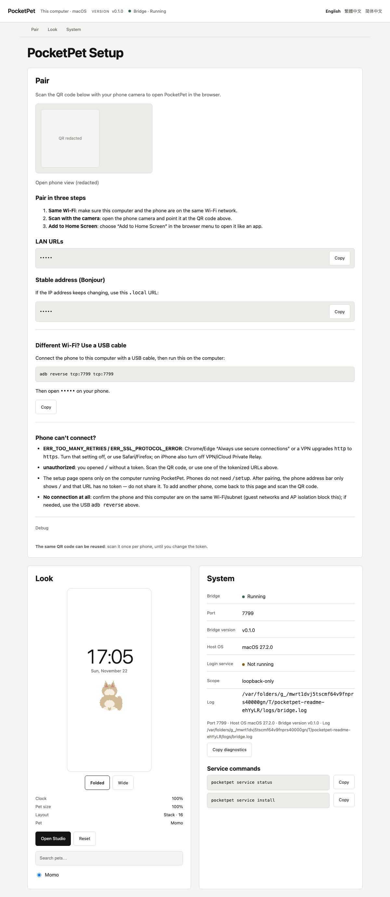
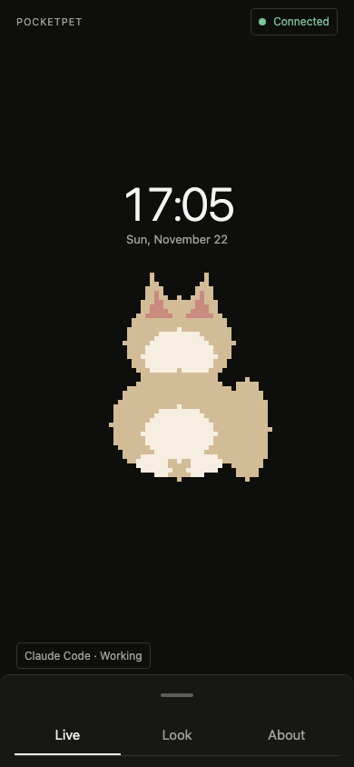
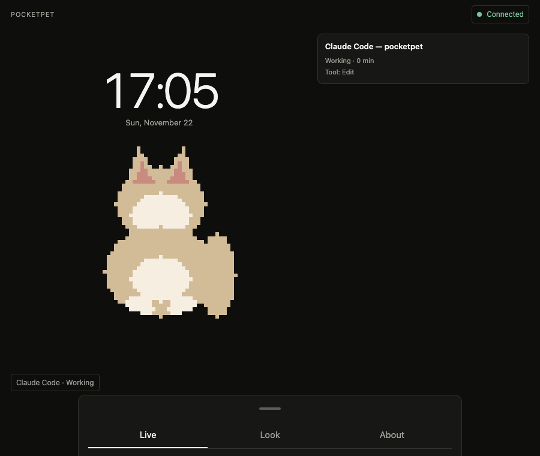
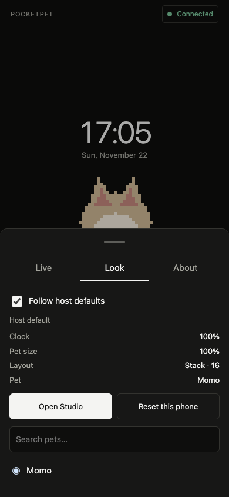
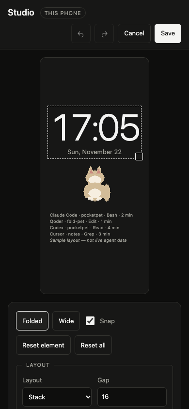

# PocketPet

[](https://github.com/HappyLiang12/pocketpet/actions/workflows/ci.yml)
[](LICENSE)
[](package.json)

[English](README.md) | [简体中文](README.zh-Hans.md)

Turn a foldable phone into a desk clock with a live AI-agent pet. The PocketPet bridge runs on the computer that hosts your agents, collects coding-agent activity, and streams it to a phone web page — no app install, no cloud.

## Features

- Zero-install phone page: scan one QR, add it to the home screen, keep it charging.
- Folded outer screen shows a clock + pet; unfolding gives a wide stage with per-agent session cards.
- Phone bottom sheet with Live, Look, and About; the phone stays a display and never controls agents.
- Loopback-only setup dashboard on the computer with Pair, Look, and System cards.
- Host default look and host pet, with per-phone local overrides that never write host state.
- One shared Direct Canvas Studio for the host and each phone: drag, resize, numeric fields, undo/redo, reset, and folded/wide preview.
- Live states from Claude Code and the included Qoder adapter; Qoder's real-app hook verification remains NOT RUN. Codex/OpenCode/Pi are next on the roadmap.
- Petdex pets: gallery search, capped picker, local installs, custom `pet.json` + spritesheet.
- One-command onboarding (`pocketpet up`), optional login service (launchd on macOS, Task Scheduler on Windows), USB fallback.
- English, Traditional Chinese, and Simplified Chinese UI; an in-page debug panel and connection troubleshooting.
- Local-first: loopback events, per-install token, no telemetry.

## Screens

Screenshots use a demo session and a custom local pet named Momo. The setup QR and pairing URLs are redacted.



<p align="center">
  
  
  
</p>

<p align="center">
  
</p>

## How to use

1. **Start the bridge.** From a checkout run `npm install && npm run build && npm link`, then `pocketpet up`. Keep the bridge running; the login service is optional.
2. **Pair once.** Open `/setup` on the computer, scan the QR with the phone camera, and add the page to the home screen. The QR is reusable; do not share the cleaned `/` URL.
3. **Read the room.** Folded shows the clock and pet; unfolded adds the wide stage and agent session cards. The phone is display-only and never controls agents.
4. **Customize.** Setup → Look → Open Studio edits **host defaults**; phone → Look → Open Studio edits **this phone**. Drag or resize the clock/pet, type exact values, preview Folded/Wide, then Save.
5. **Choose a pet.** Setup Look sets the host default; each phone can follow the host or pick a local pet. **Reset this phone** clears the local override.
6. **Connect agents.** Install hooks with consent through `pocketpet up` or `pocketpet init`. Claude Code is ready; the Qoder adapter is included but its real-app hook gate is NOT RUN. Codex/OpenCode/Pi are next; agent setup and update UI are not in this slice.
7. **Troubleshoot.** See [Troubleshooting](#troubleshooting) for HTTPS-first, unauthorized, and USB fallback.

## Requirements

PocketPet is supported on macOS and Windows 11 x64. The bridge, phone page, Studio, and token model are the same everywhere; the login service, `.local` name, and config protection are per-OS.

| Host | Support | Bridge, phone page, Studio | Agent hooks | Login service | `.local` | Config protection |
| --- | --- | --- | --- | --- | --- | --- |
| macOS (current) | Supported | Yes | Claude Code; Qoder wired, real-app gate NOT RUN | launchd LaunchAgent | Bonjour via the system responder and `scutil` | Directory 0700, files 0600 |
| Windows 11 x64 | Supported | Yes | Claude Code; Qoder wired, real-app gate NOT RUN | Per-user Task Scheduler task at logon (hidden, least privilege) | Bundled mDNS responder; starts only when the PocketPet firewall rules exist | Current-user-only NTFS ACL on home, config, logs, and launcher |
| Windows 10 22H2 x64 | Compatibility only; best-effort, not officially supported (gate NOT RUN) | Expected | Expected | Expected | Expected | Expected |
| Windows on ARM | Not claimed | Not tested | Not tested | Not tested | Not tested | Not tested |
| Linux | Best effort | Bridge only | Untested | None | None | POSIX mode bits only; no ACL promise |

- Node.js >= 20.6.
- Phone on the same WiFi as the computer (USB fallback below for different networks).
- On Windows, service install and uninstall each need one UAC prompt, and the firewall rules are Private-profile only. Linux has no service, `.local`, or ACL support claim.
- Claude Code and/or Qoder; the Qoder adapter is included with its real-app gate NOT RUN. Hooks are installed only into roots that already exist.

## Quick start

```bash
npm install
npm run build
npm link          # gives a stable `pocketpet` command for Claude hooks and the login service
pocketpet up
```

The same commands work in PowerShell on Windows 11 x64; see [Windows 11 quick start](#windows-11-quick-start).

`pocketpet up [--yes] [--no-hooks] [--no-service] [--no-open] [--qr-host ip|local]` is the one-command first run:

1. Creates `~/.pocketpet/config.json` if it is missing (POSIX mode 0700/0600, or a current-user-only Windows ACL) and prints the path — never the token.
2. Asks `Install Claude Code hooks? [Y/n]` when stdin is a terminal. `--yes` installs without asking, `--no-hooks` skips, and a non-TTY run skips with a reminder to run `pocketpet init` later. Existing settings and third-party hooks are preserved. If `~/.qoder` or `~/.qoder-cn` exists, it asks the same question for Qoder; an absent Qoder root is never created.
3. Asks `Start bridge at login? [y/N]` (default no). Answering yes, or passing `--yes`, installs the login service — `dev.pocketpet.bridge` on macOS or the hidden per-user `PocketPet Bridge` Task Scheduler task on Windows. Otherwise the bridge runs in the foreground until Ctrl+C; `--no-service` skips the question. If a bridge already answers on the configured port, `up` reprints the pairing details and reopens `/setup`.
4. Prints every LAN URL plus a full-size terminal QR code (first IPv4 address by default) and the three phone steps.
5. Opens `http://127.0.0.1:<port>/setup` in the computer's browser: a loopback-only setup dashboard with Pair, Look, and System cards. Pair shows the **IP** QR, the LAN URLs, and USB instructions; the page always shows the IP QR, so `--qr-host local` only changes the terminal QR. `--no-open` keeps the page closed.

### Windows 11 quick start

Run this in PowerShell from the checkout. No pre-elevated shell is needed; `pocketpet up` asks for elevation only for the login service.

```powershell
npm install
npm run build
npm link
pocketpet up
```

- **One UAC per service action.** Accepting the `Start bridge at login?` prompt installs the per-user `PocketPet Bridge` Task Scheduler task at logon, adds Private-profile inbound firewall rules for TCP `<port>` and UDP 5353 (scoped to the installed `node.exe`), and starts the bridge. A reboot or sign-out/sign-in restarts it with no UAC. `pocketpet service install` and `pocketpet service uninstall` each need one UAC prompt too.
- **UAC canceled or registration failed.** `pocketpet up` prints the exact elevated retry command, continues in the foreground, and does not claim the service is running. Standalone `pocketpet service install` exits 1.
- **`--no-service`.** Skips the service and UAC. It also adds no firewall rules; unless rules from an earlier service install are still present, `.local` is not advertised and pairing uses the IP URL or USB fallback.
- **Launcher and log.** The service runs a generated `%USERPROFILE%\.pocketpet\bridge-service.ps1` (PowerShell, UTF-8 with BOM) and appends to `%USERPROFILE%\.pocketpet\logs\bridge.log`. The task XML, launcher, and log contain no token, QR, or pairing URL. The home moves with `POCKETPET_HOME`.
- **Status.** `pocketpet service status` exits 0 only while the task is running; a stopped or missing task exits 1. The setup System card shows the same state.
- **Firewall.** Rules are inbound allow, Private profile only. Public and Domain networks are not opened automatically, so phone access and `.local` may fail there; `doctor` reports the reason. Adding/removing rules requires the same service elevation.
- **`.local`.** The mDNS responder advertises `<computer-name>.local` only while the PocketPet firewall rules exist and a non-loopback IPv4 address is available. The name is lowercased and sanitized to `[a-z0-9-]`; a collision is not auto-renamed. See [`.local` address](#local-address) for network prerequisites and the IP/USB fallback.
- **Config protection.** Home, `config.json`, logs, and the launcher are current-user-only by default. Administrators can take ownership, and backup tools that run as SYSTEM may not be able to read the file; see [SECURITY.md](SECURITY.md).
- **Troubleshooting.** See the Windows items in [Troubleshooting](#troubleshooting). For the manual acceptance record and read-only probe, see `docs/acceptance/windows-support.md` and `scripts/windows-acceptance.ps1`.

### Setup dashboard

`/setup` opens only on the computer running the bridge (loopback, with a Host allowlist). The phone scans the QR; it does not open `/setup`. The page is one scrolling dashboard with three anchored cards, and pairing still works without JavaScript:

- **Pair**: the server-rendered QR, LAN and `.local` URLs, USB instructions, the reusable-QR note, and an **Open phone view** action.
- **Look**: a folded/wide preview, the host default appearance, the host pet picker, **Open Studio**, and a host reset. Host defaults are written only from this setup UI.
- **System**: bridge and login-service status, port, bridge version, the actual host OS and version, the loopback scope, log path, copy diagnostics, and service commands.

Agent and update cards, agent setup, and update controls are not part of this slice; they remain later work. No agent setup or update UI is added here.

### On the phone

No app and no phone-side configuration:

1. Join the same WiFi as the computer.
2. Point the phone **camera** at the QR code and open the link — no adb needed.
3. Add the page to the home screen and keep it open while charging.

Controls live in a bottom sheet with three tabs:

- **Live** (default) shows connection state, an **Edit look** action, and the one-time add-to-home hint.
- **Look** shows the host-default summary, **Follow host defaults**, the pet picker, **Open Studio**, and **Reset this phone**.
- **About** holds the language selector, Wake Lock status, computer/bridge details, and troubleshooting.

The same QR is reusable: every phone scans it once and stays paired until you change the token in `~/.pocketpet/config.json`. Do not share the cleaned `/` URL (it has no token and returns 401), and do not open `/setup` on a phone — it only opens on the computer running the bridge.

Host defaults are the starting point for every phone. Each phone follows the host by default; turning **Follow host defaults** off, or saving from the phone Studio, keeps a local override that stays on that phone and never writes the host. **Reset this phone** clears the local override and turns follow-host back on. If the browser blocks local storage, the phone still boots with host values and notes that changes last only until reload.

The token in `?token=...` is stored as an HttpOnly cookie and then removed from the address bar, so the visible and bookmarked URL is just `/`. The API, WebSocket, and reloads keep using that cookie. The one-time add-to-home hint appears in Live; dismissing it is remembered on that phone and hidden automatically when the page already runs standalone.

### Look and Studio

Host defaults and phone overrides use the same appearance schema, and both surfaces open the same Direct Canvas Studio:

- **Setup** → Look → **Open Studio** edits **Host defaults** and saves through the setup API.
- **Phone** → Look → **Open Studio** edits **This phone** and saves a sparse local override; no host write is made.

Drag or resize the clock and pet, or use numeric fields for exact values. The Studio also provides undo/redo, Reset element, Reset all, a Folded/Wide preview, snapping, and theme, motion, layout, and session-density controls. Keyboard access: Tab selects an element, arrows move by 1%, Shift+arrows move by 10%, `+`/`-` scale, and Escape cancels or closes. The setup preview frames are approximate; the phone preview uses its real viewport.

### `.local` address

Next to each IP URL, `pocketpet up` prints a `.local` name when the host can advertise one:

- **macOS** reads the computer's Bonjour name from `scutil --get LocalHostName` (for example `http://my-computer.local:7788/?token=...`). The system responder is always available.
- **Windows 11** advertises the sanitized computer name through a bundled mDNS responder (for example `http://my-pc.local:7788/?token=...`). Advertisement starts only while the PocketPet firewall rules exist, so install the login service first; foreground `run` without those rules has no `.local` name. iOS resolves it through Bonjour; Android support varies by version and network.

A `.local` name survives DHCP address changes, but it depends on multicast DNS: some WiFi networks, guest networks, AP isolation, VPNs, and corporate filters block it. Hostname collisions are not auto-renamed. The QR keeps using the IP by default; `--qr-host local` puts the `.local` URL in the terminal QR only when the name is live (the `/setup` page still renders the IP QR). The `.local` address is not the universal default until it is verified on both Android and iPhone, so keep the IP or USB fallback ready. On Windows, `pocketpet doctor` reports `PASS mdns` only while the responder is advertising.

### Login service

```bash
pocketpet service install    # macOS: LaunchAgent dev.pocketpet.bridge; Windows: PocketPet Bridge task at logon
pocketpet service status     # exit 0 + "running" line, exit 1 + "not running" line
pocketpet service uninstall  # stops it and removes the launchd job or scheduled task
```

On macOS the service runs `<node> <dist/cli.js> run --service`, which prints only `PocketPet bridge listening on port N`. The token, URLs, and QR never reach the service log `~/.pocketpet/logs/bridge.log` (file 0600, directory 0700).

On Windows the same command runs from a generated `bridge-service.ps1` launcher through the hidden per-user Task Scheduler task. Install and uninstall each need one UAC prompt; logon does not. The launcher, task XML, and log are token-free, and the log lives at `%USERPROFILE%\.pocketpet\logs\bridge.log` (or under `POCKETPET_HOME`). Uninstall leaves config, pets, cache, and logs in place. A source `.ts` entry point is refused on both platforms; install the service from the built `dist/cli.js`.

Run `pocketpet up` again while the service is running to reprint the QR and reopen `/setup`.

### Qoder adapter

`pocketpet init` and `pocketpet up` wire Qoder user-level hooks into every existing root (`~/.qoder/settings.json` and `~/.qoder-cn/settings.json`) and never create a root that was not already there. The compiled CLI writes an absolute `<node> <dist/cli.js> hook qoder` command because the Qoder GUI may not inherit the shell `PATH`; a source (tsx) run falls back to the linked `pocketpet hook qoder`. On Windows the command is fully double-quoted (`"<node>" "<dist/cli.js>" hook qoder`) so paths with spaces survive, and rerunning `init`/`up` upgrades a stale bare entry instead of adding a duplicate. Existing settings, foreign hooks, and `hooksConfig` are left untouched.

The Qoder adapter is included in this release, but it is not presented as fully verified support: the real-app gate is NOT RUN. Qoder desktop 0.5.17 has not yet been observed executing a hand-written user-level hook. Its plugin hooks do execute, and the user-level path is documented, but the end-to-end payload is unverified. Install Qoder hooks with consent, run a Qoder task, and confirm the phone pet reacts before treating Qoder support as fully shipped. See `docs/research/qoder-events.md` and `docs/acceptance/m3-qoder-manual.md` (result: NOT RUN).

### Port

The port lives in `~/.pocketpet/config.json` (default 7788). `POCKETPET_PORT` overrides it only while a **new** config is created: an integer 0–65535; invalid values fall back to 7788. Existing configs are never rewritten — edit `port` in the config file to change it later. `POCKETPET_PORT=0` asks the OS for a free port and is for automated tests only: do not persist port 0 in a real config, because the next start gets a different port and previously printed QR codes/URLs stop matching.

## Always-on screen

The page requests the Screen Wake Lock when the browser allows it. Over plain HTTP on a LAN IP the Wake Lock API is unavailable, so set the phone's auto-lock to Never (iOS) or extend the screen timeout / enable Stay awake (Android). A one-time local HTTPS certificate option may come later.

## USB fallback (different networks)

macOS Monterey and later removed Bluetooth PAN/tethering, so Bluetooth is not a fallback on current macOS releases. The same USB method works on Windows (install Android platform-tools and enable USB debugging). When the phone and computer are on different networks, connect the phone by USB with debugging enabled and forward the bridge port:

```bash
adb reverse tcp:7788 tcp:7788
```

Then open `http://127.0.0.1:7788/?token=...` on the phone (the token is in the `pocketpet up`/`pocketpet run` output, and the `/setup` page repeats the USB command with the configured port). `127.0.0.1` is a secure context, so the Wake Lock can stay active. Pet state is tiny; the USB link is plenty. When no LAN URL exists, `pocketpet up` prints these two USB steps instead of a QR.

## Pets

PocketPet scans three local roots in order: `~/.pocketpet/pets`, `~/.codex/pets`, then `~/.petdex/pets`. The first copy of a slug wins.

- Install from the Petdex gallery: `npx petdex install boba` (lands in `~/.codex/pets` or `~/.petdex/pets` depending on the Petdex version).
- Or drop a pet folder (`pet.json` + `spritesheet.webp|png`, 8×9 or 8×11 atlas) into `~/.pocketpet/pets`.
- Set the host default pet in the setup page Look card. Each phone can keep following the host or choose a local pet in its Look tab; **Reset this phone** returns to the host pet. Use the search box to filter the Petdex gallery (local pets stay pinned). Use the same Petdex slug on desktop to show the same character.

## Commands

- `pocketpet up` — first-run setup: config, hooks consent, optional login service, full-size QR, `/setup`
- `pocketpet service install|uninstall|status` — manage the login item (launchd on macOS, Task Scheduler on Windows)
- `pocketpet init` — create config and Claude/Qoder hooks (still available for scripted setup)
- `pocketpet run` — start the bridge in the foreground and print the QR; auto-creates a missing config and reminds you that hooks need `init`
- `pocketpet doctor` — check config, hooks, pets, port, and on Windows also the config ACL, task, firewall content, and live `.local`
- `pocketpet hook claude` — internal; called by Claude Code hooks
- `pocketpet hook qoder` — internal; called by Qoder hooks

## Status

Current: M1 + onboarding + Qoder adapter (included; real-app gate NOT RUN) + UIUX foundation + Windows 11 x64 support. One-command setup (`pocketpet up`), the loopback setup dashboard with Pair/Look/System, launchd (macOS) and Task Scheduler (Windows) login services, the Claude Code adapter, a Studio Neutral phone display with a Live/Look/About bottom sheet, host default appearance and pet with per-phone local overrides, the shared Direct Canvas Studio, folded/wide display, Petdex catalog, USB fallback, English/繁體中文/简体中文 UI, and an in-page debug panel. Windows 11 x64 is the official Windows host; Windows 10 22H2 is compatibility-only, and Windows on ARM/Linux remain best-effort without a support promise. The Qoder adapter is included; its real-app gate is NOT RUN. Agent setup and update UI are out of this slice; the updater mechanism is a separate specification. Codex/OpenCode/Pi adapters, pet upload, and making `.local` the default QR host are later milestones. See `docs/superpowers/specs/2026-11-21-pocketpet-design.md`, `docs/superpowers/specs/2026-11-21-pocketpet-uiux-direction-design.md`, and `docs/superpowers/specs/2026-11-23-pocketpet-windows-support-design.md`; real-machine Windows evidence lives in `docs/acceptance/windows-support.md`.

## Troubleshooting

- `ERR_TOO_MANY_RETRIES` / `ERR_SSL_PROTOCOL_ERROR`: the phone browser is forcing HTTPS (Chrome/Edge “Always use secure connections”), or a VPN/proxy is intercepting. Turn that setting off, try Safari/Firefox, or disable VPN/iCloud Private Relay. The LAN bridge is HTTP-only; local HTTPS/tunnel is a later option.
- `unauthorized`: you opened the cleaned `/` URL without the token. Scan the QR or use the tokenized URL listed on `/setup`.
- `Setup page opens on the computer` / `配對頁在電腦上開啟`: `/setup` only opens on the computer running the bridge; phones scan the QR.
- Can't reach the computer at all: confirm the phone is on the same WiFi/subnet (guest networks and AP isolation block it); otherwise use USB `adb reverse`.
- Windows: `pocketpet service install` was canceled or failed; re-run it from a normal PowerShell and accept the one UAC prompt, or keep using `--no-service` and the IP/USB URL. The retry command is printed by `pocketpet up`.
- Windows phone access or `.local` fails: check that the network profile is Private (Settings → Network & Internet → Wi-Fi → network properties), that both PocketPet firewall rules pass `pocketpet doctor`, and that the router/VPN does not block multicast. Public/Domain profiles and AP isolation are intentionally not opened; use the IP URL or USB fallback.
- Windows service does not start at logon: run `pocketpet service status` and `pocketpet doctor`, then inspect `%USERPROFILE%\.pocketpet\logs\bridge.log`. Reinstall with `pocketpet service install`; the task is a per-user logon task and needs an interactive sign-in.
- Windows config unreadable by a backup tool: the home and config are current-user-only by default. Administrators can take ownership; run the backup as the signed-in user or exclude the path. See [SECURITY.md](SECURITY.md).

## Security

Events are accepted only from loopback. The phone API requires the per-install token; the QR carries it once, the browser stores it as an HttpOnly cookie for one year (so a browser restart does not require a rescan), and the page removes `?token=` from the address bar after load. The token still appears in the terminal output and in the server-rendered QR and URL text on the loopback-only `/setup` page; setup APIs never return it, and the service log never contains it. Avoid sharing screenshots that show the QR, URLs, or setup page. `/setup` is loopback-only and Host-allowlisted; setup writes require a same-origin request with the setup header. The phone writes only its local override object — never the host appearance or host pet. `/setup` is not cached (`Cache-Control: no-store`). No cloud, no telemetry. Events contain agent/session/project/tool names only — never code, prompts, or outputs.

On Windows, `%USERPROFILE%\.pocketpet` and its config, logs, and launcher are protected by a current-user-only ACL (inheritance removed, other entries deleted) and the bridge fails closed if protection cannot be verified. Administrators can take ownership, and SYSTEM-run backup tools may not be able to read the file. The Task Scheduler XML, launcher, and log contain no token; firewall rules are Private-profile only. See [SECURITY.md](SECURITY.md).

## Credits

- [Petdex](https://petdex.dev) — open-source pet format, gallery, and manifest (MIT). Pet art is owned by its submitters; PocketPet does not bundle pet art and reads locally installed packages.
- [Clawd on Desk](https://github.com/rullerzhou-afk/clawd-on-desk) — architecture reference only (AGPL-3.0); no code was copied.
- Qoder, Claude Code, Codex, OpenCode, Pi, and other agent names are trademarks of their respective owners. PocketPet is not affiliated with them.

## Contributing

See [CONTRIBUTING.md](CONTRIBUTING.md). Security reports go through GitHub Security Advisories; see [SECURITY.md](SECURITY.md).

## License

MIT — see [LICENSE](LICENSE).
