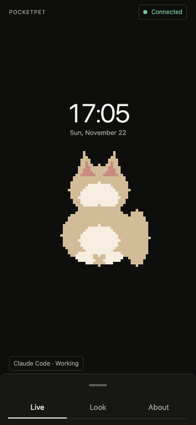
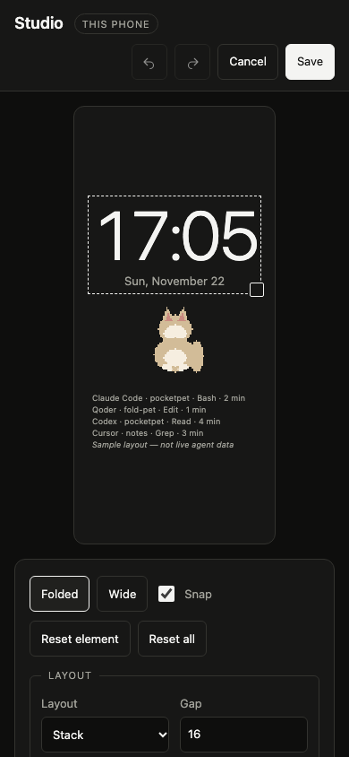

# PocketPet

[English](README.md) | 简体中文

把折叠手机变成桌面时钟 + 实时 AI coding agent 宠物。PocketPet bridge 运行在托管 agent 的电脑上，收集 coding agent 的活动，通过 WiFi 推送到手机网页；无需安装 app、无需账号、无需云。

## 界面

截图使用 demo session 和名为 Momo 的自定义本地宠物；设置页的 QR 与配对网址已遮罩。


<p align="center">
  
  
  
</p>

<p align="center">
  
</p>

## 使用方法

1. **启动 bridge。** 在 checkout 运行 `npm install && npm run build && npm link`，再运行 `pocketpet up`。bridge 需要保持运行；登录服务可选。
2. **配对一次。** 在电脑打开 `/setup`，用手机相机扫描 QR，再选择「添加到主屏幕」。QR 可重复使用；不要分享只剩 `/` 的地址。
3. **看状态。** 折叠时显示时钟和宠物；展开时加入宽屏舞台和 agent session cards。手机只显示，不控制 agent。
4. **自定义。** 设置页 → Look → Open Studio 修改**主机默认**；手机 → Look → Open Studio 只修改**此手机**。可拖动/缩放时钟与宠物、输入精确数字、预览折叠/展开，然后保存。
5. **选宠物。** 设置页 Look 设定主机默认；每部手机可跟随主机或选择本地宠物。「重置此手机」清除本地覆盖。
6. **连接 agent。** 通过 `pocketpet up` 或 `pocketpet init` 明确同意后安装 hooks。Claude Code 已就绪；Qoder adapter 已包含，但真实 app hooks 验收为 NOT RUN。Windows 上写入完整双引号的绝对命令（`"<node>" "<dist/cli.js>" hook qoder`），重复运行会把旧的裸命令升级为绝对形式，而不是叠加重复项。Codex/OpenCode/Pi 是后续适配器；agent 设置与更新 UI 不在本切片。
7. **疑难排解。** 见下方「USB fallback」以及 [疑难解答](#疑难解答)（HTTPS-first / unauthorized / USB）。

## 要求

PocketPet 支持 macOS、Windows 11 x64 与 Windows 10 22H2 x64。Bridge、手机页面、Studio 与 token 模型在各平台一致；登录服务、`.local` 名称与配置保护按系统不同。

| 主机 | 支持 | Bridge、手机页面、Studio | Agent hooks | 登录服务 | `.local` | 配置保护 |
| --- | --- | --- | --- | --- | --- | --- |
| macOS（当前） | 支持 | 是 | Claude Code；Qoder 已接线，真实 app 验收 NOT RUN | launchd LaunchAgent | 系统 Bonjour 与 `scutil` | 目录 0700、文件 0600 |
| Windows 11 x64 | 支持 | 是 | Claude Code；Qoder 已接线，真实 app 验收 NOT RUN | 登录时启动的当前用户 Task Scheduler 任务（隐藏、最低权限） | 随应用提供的 mDNS responder；bridge 启动时必须已有 PocketPet 防火墙规则（之后删除规则不会撤回已在运行的广播） | home、config、logs 与 launcher 的当前用户专属 NTFS ACL |
| Windows 10 22H2 x64 | 支持 | 是 | Claude Code；Qoder 已接线，真实 app 验收 NOT RUN | 登录时启动的当前用户 Task Scheduler 任务（隐藏、最低权限） | 随应用提供的 mDNS responder；bridge 启动时必须已有 PocketPet 防火墙规则（之后删除规则不会撤回已在运行的广播） | home、config、logs 与 launcher 的当前用户专属 NTFS ACL |
| Windows on ARM | 未声明 | 未测试 | 未测试 | 未测试 | 未测试 | 未测试 |
| Linux | 尽力支持 | 仅 bridge | 未测试 | 无 | 无 | 仅 POSIX mode bits；无 ACL 承诺 |

Windows 10 22H2 x64 已由用户根据实机结果纳入支持：bridge、ACL、服务安装、防火墙与手机 IP 已验证；uninstall/reinstall、登录持久化、手机 `.local`、Qoder 真实 app 与官方 Windows 11 x64 实机验收仍为 NOT RUN。Windows CI matrix 已在 PR 通过。见[验收记录](docs/acceptance/windows-support.md)。

- Node.js >= 20.6。
- 手机与运行 bridge 的电脑在同一 WiFi（不同网络可用 USB `adb reverse`）。
- Windows 上安装与卸载服务各需要一次 UAC，防火墙规则仅限 Private 配置文件。Linux 不承诺服务、`.local` 或 ACL。
- 当前包含 Claude Code 与 Qoder adapter；Qoder 的真实 app 验收为 NOT RUN。hooks 只会安装到已经存在的目录。

## 快速开始

```bash
npm install
npm run build
npm link
pocketpet up
```

`pocketpet up` 会创建 `~/.pocketpet`、询问是否安装 hooks、询问是否开机启动 bridge，然后打印大 QR，并在运行 bridge 的电脑上打开 `http://127.0.0.1:<port>/setup` 设置页。

### Windows 快速开始

在 PowerShell 中于 checkout 运行；不需要预先打开管理员终端，只有登录服务会触发一次 UAC：

```powershell
npm install
npm run build
npm link
pocketpet up
```

- **每次服务操作一次 UAC。** 接受 `Start bridge at login?` 后会安装当前用户的 `PocketPet Bridge` 登录任务，添加仅限 Private 的入站防火墙规则（TCP `<port>` 与 UDP 5353，作用域为当前 `node.exe`），并启动 bridge。重启或注销再登录后无需 UAC 即可自动启动。`pocketpet service install` 与 `pocketpet service uninstall` 也各需要一次 UAC。
- **UAC 取消或注册失败。** `pocketpet up` 会打印可粘贴到管理员 PowerShell 的完整重试命令，继续在前台运行，并且不会声称服务已在运行。单独运行 `pocketpet service install` 会以退出码 1 结束。
- **`--no-service`。** 跳过服务与 UAC，也不会添加防火墙规则；若此前安装服务留下的 PocketPet 规则在 bridge 启动时仍存在，`.local` 仍可能广播；否则请使用 IP 或 USB 地址。
- **Launcher 与日志。** 服务运行生成的 `%USERPROFILE%\.pocketpet\bridge-service.ps1`（PowerShell，UTF-8 带 BOM），日志追加到 `%USERPROFILE%\.pocketpet\logs\bridge.log`。任务 XML、launcher 与日志都不含 token、QR 或配对网址。设置 `POCKETPET_HOME` 可改变默认目录。
- **状态。** `pocketpet service status` 只在任务运行时以 0 退出；停止或缺失时以 1 退出。设置页 System 区域显示同一状态。
- **防火墙。** 规则为入站允许、仅 Private。Public 与 Domain 网络不会自动开放，因此手机访问与 `.local` 可能失败，`doctor` 会说明原因；增删规则需要服务安装时的同一次提权。
- **`.local`。** 仅当 bridge 启动时两条 PocketPet 防火墙规则都存在且存在非 loopback IPv4 地址，mDNS responder 才广播 `<computer-name>.local`；检查只在启动时进行，之后删除规则不会撤回已在运行的广播，需重启 bridge 才生效。名称会转为小写并规范为 `[a-z0-9-]`；重名不会自动改名。网络前提与 IP/USB 回退见下方「`.local` 地址与登录服务」。
- **配置保护。** home、`config.json`、logs 与 launcher 默认仅当前用户可访问。管理员可以取得所有权，以 SYSTEM 运行的备份工具可能无法读取；见 [SECURITY.md](SECURITY.md)。
- **疑难排解。** 见「疑难解答」中的 Windows 条目。真实机器验收模板与只读探测脚本见 `docs/acceptance/windows-support.md` 与 `scripts/windows-acceptance.ps1`。

## 设置页

`/setup` 只在运行 bridge 的电脑上打开（仅 loopback，并校验 Host）；手机只扫描 QR，不需要打开 `/setup`。设置页是一页式 dashboard，包含 Pair（配对）、Look（外观）、System（系统）三个区域；没有 JavaScript 时仍可查看 QR、网址和 USB 指令。

- Pair：QR、局域网与 `.local` 网址、USB 指令、可重复使用说明，以及「打开手机画面」。
- Look：折叠/展开预览、主机默认外观、主机默认宠物选择、Open Studio、重置主机外观。主机默认外观和宠物只通过这个设置页 UI 修改。
- System：bridge 与登录服务状态、端口、bridge 版本、实际系统与版本、loopback 范围、日志路径、复制诊断信息、服务命令。

Agents 和 Updates 卡片、agent 设置与更新界面不在此切片内，属于后续规格。

同一个 QR 可以重复使用，每部手机各扫一次；更改 `~/.pocketpet/config.json` 里的 token 后，所有手机都需要重新配对。不要分享配对后只剩 `/` 的地址（它没有 token）。

## 手机端

1. 连接与电脑相同的 WiFi。
2. 用**手机相机**扫描电脑屏幕上的 QR。
3. 选择「添加到主屏幕」，充电时保持打开。

手机界面使用底部面板，包含 Live（即时）、Look（外观）、About（关于）三个标签：

- Live：连接状态、编辑外观入口、一次性的「添加到主屏幕」提示。
- Look：主机默认摘要、跟随主机默认、宠物选择、Open Studio、重置此手机。
- About：语言、Wake Lock 状态、电脑与 bridge 信息、疑难解答。

主机默认外观和宠物在设置页的 Look 中修改。每部手机默认跟随主机；关闭「跟随主机默认」或在手机 Studio 中保存后，该手机保留本地覆盖。本地修改只存在于这部手机，不会写入主机默认值。「重置此手机」会清除本地覆盖并恢复跟随主机。浏览器禁止本地存储时，页面仍会启动并使用主机值，同时在 Look 中提示更改只在重新加载前有效。

## Direct Canvas Studio

设置页与手机共用同一个 Direct Canvas Studio：

- 设置页：Look → Open Studio，范围显示为「主机默认」，保存写入主机默认值。
- 手机：Look → Open Studio，范围显示为「此手机」，保存只写入本机覆盖，不写入主机。

可以拖动或缩放时钟与宠物，也可以用数字输入精确设置；支持撤销/重做、重置元素/全部重置、折叠/展开预览、对齐，以及主题、动效、布局、会话密度等外观项。键盘可用 Tab 选择元素、方向键移动 1%、Shift+方向键移动 10%、`+`/`-` 缩放、Escape 取消或关闭。设置页的折叠/展开框是近似预览；手机使用真实视口。

## `.local` 地址与登录服务

只要主机能广播，`pocketpet up` 会在 IP 网址旁打印 `.local` 名称：

- **macOS** 使用 `scutil --get LocalHostName`（例如 `http://my-computer.local:7788/?token=...`），系统 Bonjour responder 始终可用。
- **Windows 11** 通过随应用提供的 mDNS responder 广播规范化后的计算机名（例如 `http://my-pc.local:7788/?token=...`）。bridge 启动时两条 PocketPet 防火墙规则必须都存在，因此请先安装登录服务；没有规则的前台 `run` 不提供 `.local`。该检查只在启动时进行：之后删除规则不会撤回已在应答的广播，需要重启 bridge 才生效。iOS 通过 Bonjour 解析，Android 依版本与网络而异。

`.local` 可承受 DHCP 地址变化，但依赖 multicast DNS：部分 WiFi、访客网络、AP 隔离、VPN 与企业网络会阻挡。重名不会自动改名。QR 默认仍使用 IP；`--qr-host local` 只在名称实际可用时改变终端 QR（`/setup` 页面仍显示 IP QR）。在 Android 与 iPhone 都验证之前，`.local` 不是默认配对方式，请保留 IP 或 USB 回退。Windows 上 `pocketpet doctor` 只在 responder 广播期间显示 `PASS mdns`。

```bash
pocketpet service install    # macOS: LaunchAgent dev.pocketpet.bridge；Windows: 登录时的 PocketPet Bridge 任务
pocketpet service status     # 运行时退出 0 并显示 running；否则退出 1
pocketpet service uninstall  # 停止并删除 launchd 任务或计划任务
```

macOS 服务运行 `<node> <dist/cli.js> run --service`，只输出 `PocketPet bridge listening on port N`；token、网址与 QR 不会写入 `~/.pocketpet/logs/bridge.log`（文件 0600、目录 0700）。

Windows 上同一命令由生成的 `bridge-service.ps1` 经隐藏的当前用户计划任务运行。安装与卸载各需一次 UAC，登录时不需要。launcher、任务 XML 与日志都不含 token；日志位于 `%USERPROFILE%\.pocketpet\logs\bridge.log`（或 `POCKETPET_HOME` 下）。卸载会保留 config、宠物、缓存与日志。两个平台都拒绝从源码 `.ts` 安装服务，请使用构建后的 `dist/cli.js`。

服务运行时再次执行 `pocketpet up` 可重新打印 QR 并打开 `/setup`。

## 语言

应用界面支持 **English / 繁體中文 / 简体中文**：

- 手机端：About 标签中的语言选择，选择会保存在该手机。
- 设置页：URL 加 `?lang=en`、`?lang=zh-Hant`、`?lang=zh-Hans`。

## 宠物

支持 Petdex 宠物包：`~/.pocketpet/pets`、`~/.codex/pets`、`~/.petdex/pets`（同名 slug 以先扫描到的为准）。主机默认宠物在设置页 Look 中选择；手机可在 Look 中跟随主机或选择本地宠物。搜索框可过滤 Petdex 画廊，本地宠物保持置顶。桌面端使用同一个 Petdex slug 可显示同一个角色。

## USB fallback（不同网络）

macOS Monterey 之后已移除 Bluetooth PAN；Windows 上同样可用下列 USB 方法（需安装 Android platform-tools 并启用 USB 调试）。不同网络时，用 USB 连接手机并在电脑运行：

```bash
adb reverse tcp:7788 tcp:7788
```

然后在手机打开 `http://127.0.0.1:7788/?token=...`（token 在 `pocketpet up` 输出或 `/setup` 页）。`127.0.0.1` 是安全上下文，Wake Lock 可保持启用。

## 状态与平台范围

当前：M1 + onboarding + Qoder adapter（已包含；真实 app 验收 NOT RUN）+ UIUX foundation + Windows 11/10 支持。包含一键设置（`pocketpet up`）、loopback 设置页（Pair/Look/System）、launchd（macOS）与 Task Scheduler（Windows）登录服务、Claude Code 适配器、带 Live/Look/About 底部面板的 Studio Neutral 手机界面、主机默认外观与宠物及每部手机的本地覆盖、共享 Direct Canvas Studio、折叠/展开显示、Petdex 目录、USB fallback、English/繁體中文/简体中文界面和调试面板。

Windows 11 x64 与 Windows 10 22H2 x64 是支持的 Windows 主机；Windows on ARM 未测试且未声明，Linux 仅尽力支持且没有支持承诺。Qoder adapter 已包含；真实 app 验收为 NOT RUN。Agent 设置与更新界面不在本切片内；更新机制是另一份规格。Codex/OpenCode/Pi 适配器、宠物上传，以及把 `.local` 设为默认 QR 主机都是后续里程碑。设计见 `docs/superpowers/specs/2026-11-23-pocketpet-windows-support-design.md`，真实机器验收见 `docs/acceptance/windows-support.md`。

## 疑难解答

- `ERR_TOO_MANY_RETRIES` / `ERR_SSL_PROTOCOL_ERROR`：手机浏览器强制 HTTPS（Chrome/Edge「始终使用安全连接」）或 VPN 代理拦截。关闭该设置，改用 Safari/Firefox，或关闭 VPN/iCloud Private Relay。局域网 bridge 只提供 HTTP；本地 HTTPS/tunnel 是后续选项。
- `unauthorized`：打开了没有 token 的 `/`。扫描 QR，或使用 `/setup` 上列出的带 token 网址。
- 设置页只在电脑上打开：`/setup` 只在运行 bridge 的电脑上打开；手机扫描 QR。
- 完全连不上电脑：确认手机与电脑在同一 WiFi/subnet（访客网络与 AP 隔离会阻挡）；否则使用 USB `adb reverse`。
- Windows 上 `pocketpet service install` 被取消或失败：在普通 PowerShell 重新运行并接受一次 UAC，或继续使用 `--no-service` 与 IP/USB 地址；`pocketpet up` 会打印重试命令。
- Windows 上手机或 `.local` 连不上：确认网络配置文件为 Private（设置 → 网络和 Internet → Wi-Fi → 网络属性），`pocketpet doctor` 中两条 PocketPet 防火墙规则通过，路由器/VPN 未阻止 multicast。Public/Domain 网络与 AP 隔离不会自动开放；请使用 IP 或 USB。
- Windows 登录后服务未启动：运行 `pocketpet service status` 与 `pocketpet doctor`，查看 `%USERPROFILE%\.pocketpet\logs\bridge.log`，再用 `pocketpet service install` 重装。该任务是当前用户的登录任务，需要交互式登录。
- Windows 备份工具无法读取 config：默认仅当前用户可访问；管理员可取得所有权，请以当前用户运行备份或排除该路径。见 [SECURITY.md](SECURITY.md)。

## 安全

Bridge 只接受 loopback 的 agent 事件；手机 API 需要每安装一次生成的 token。`/setup` 仅 loopback 并校验 Host；setup 写入需要同源请求和 setup header。Setup API 不会返回配对 token，token 只出现在服务端渲染的 QR 与网址文本中。手机只写入本地外观覆盖，不写主机默认外观或主机宠物。没有遥测、没有云、事件不含代码/prompt/输出。

Windows 上 `%USERPROFILE%\.pocketpet` 及其 config、logs、launcher 使用当前用户专属 ACL（移除继承与其他条目）；无法验证保护时 bridge 拒绝启动。管理员可以取得所有权，以 SYSTEM 运行的备份工具可能无法读取。任务 XML、launcher 与日志不含 token；防火墙规则仅限 Private。详见 [SECURITY.md](SECURITY.md)。

## 许可与致谢

MIT。宠物格式与画廊来自 [Petdex](https://petdex.dev)（MIT）；宠物图像版权属于各提交者，本项目不分发宠物图。架构参考 [Clawd on Desk](https://github.com/rullerzhou-afk/clawd-on-desk)（AGPL，仅参考，未复制代码）。各 agent 名称/商标属于其所有者，本项目与其无隶属关系。
