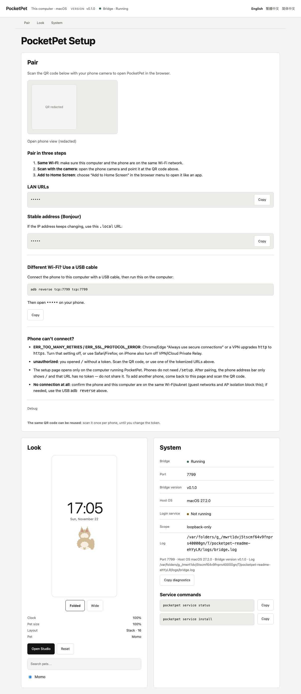
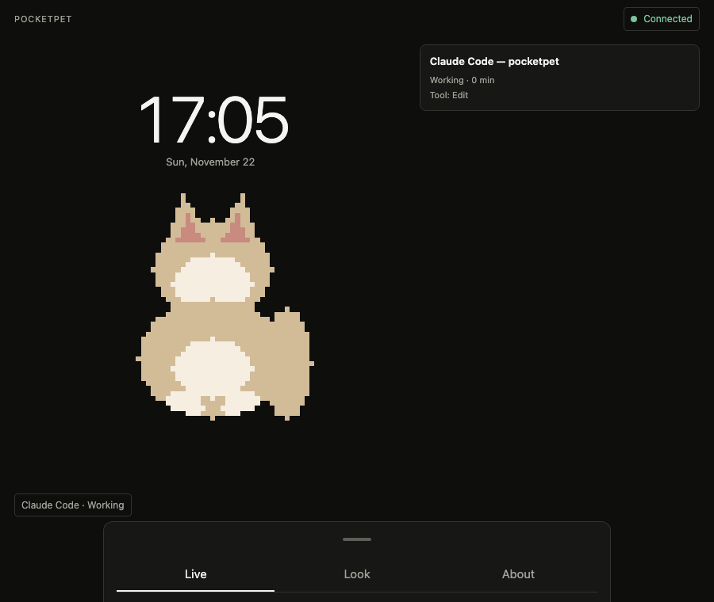
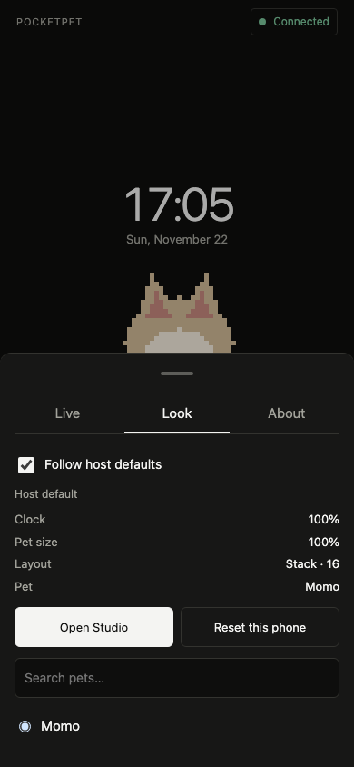

# PocketPet

[English](README.md) | 简体中文

把折叠手机变成桌面时钟 + 实时 AI coding agent 宠物。PocketPet bridge 运行在托管 agent 的电脑上，收集 coding agent 的活动，通过 WiFi 推送到手机网页；无需安装 app、无需账号、无需云。

## 界面

截图使用 demo session 和名为 Momo 的自定义本地宠物；设置页的 QR 与配对网址已遮罩。



<p align="center">
  
  
  
</p>

<p align="center">
  
</p>

## 使用方法

1. **启动 bridge。** 在 checkout 运行 `npm install && npm run build && npm link`，再运行 `pocketpet up`。bridge 需要保持运行；登录服务可选。
2. **配对一次。** 在电脑打开 `/setup`，用手机相机扫描 QR，再选择「添加到主屏幕」。QR 可重复使用；不要分享只剩 `/` 的地址。
3. **看状态。** 折叠时显示时钟和宠物；展开时加入宽屏舞台和 agent session cards。手机只显示，不控制 agent。
4. **自定义。** 设置页 → Look → Open Studio 修改**主机默认**；手机 → Look → Open Studio 只修改**此手机**。可拖动/缩放时钟与宠物、输入精确数字、预览折叠/展开，然后保存。
5. **选宠物。** 设置页 Look 设定主机默认；每部手机可跟随主机或选择本地宠物。「重置此手机」清除本地覆盖。
6. **连接 agent。** 通过 `pocketpet up` 或 `pocketpet init` 明确同意后安装 hooks。Claude Code 已就绪；Qoder adapter 已包含，但真实 app hooks 验收为 NOT RUN。Codex/OpenCode/Pi 是后续适配器；agent 设置与更新 UI 不在本切片。
7. **疑难排解。** 见下方「USB fallback」以及 [疑难解答](#疑难解答)（HTTPS-first / unauthorized / USB）。

## 要求

- macOS，Node.js >= 20.6。当前 bridge 与登录服务仅支持 macOS；Windows/Linux 的 bridge 与服务支持是另一份规格。界面显示实际系统标签（例如 macOS），不假设运行平台。
- 手机与运行 bridge 的电脑在同一 WiFi（不同网络可用 USB `adb reverse`）。
- 当前包含 Claude Code 与 Qoder adapter；Qoder 的真实 app 验收为 NOT RUN。hooks 只会安装到已经存在的目录。

## 快速开始

```bash
npm install
npm run build
npm link
pocketpet up
```

`pocketpet up` 会创建 `~/.pocketpet`、询问是否安装 hooks、询问是否开机启动 bridge，然后打印大 QR，并在运行 bridge 的电脑上打开 `http://127.0.0.1:<port>/setup` 设置页。

## 设置页

`/setup` 只在运行 bridge 的电脑上打开（仅 loopback，并校验 Host）；手机只扫描 QR，不需要打开 `/setup`。设置页是一页式 dashboard，包含 Pair（配对）、Look（外观）、System（系统）三个区域；没有 JavaScript 时仍可查看 QR、网址和 USB 指令。

- Pair：QR、局域网与 `.local` 网址、USB 指令、可重复使用说明，以及「打开手机画面」。
- Look：折叠/展开预览、主机默认外观、主机默认宠物选择、Open Studio、重置主机外观。主机默认外观和宠物只通过这个设置页 UI 修改。
- System：bridge 与登录服务状态、端口、bridge 版本、实际系统与版本、loopback 范围、日志路径、复制诊断信息、服务命令。

Agents 和 Updates 卡片、agent 设置与更新界面不在此切片内，属于后续规格。

同一个 QR 可以重复使用，每部手机各扫一次；更改 `~/.pocketpet/config.json` 里的 token 后，所有手机都需要重新配对。不要分享配对后只剩 `/` 的地址（它没有 token）。

## 手机端

1. 连接与电脑相同的 WiFi。
2. 用**手机相机**扫描电脑屏幕上的 QR。
3. 选择「添加到主屏幕」，充电时保持打开。

手机界面使用底部面板，包含 Live（即时）、Look（外观）、About（关于）三个标签：

- Live：连接状态、编辑外观入口、一次性的「添加到主屏幕」提示。
- Look：主机默认摘要、跟随主机默认、宠物选择、Open Studio、重置此手机。
- About：语言、Wake Lock 状态、电脑与 bridge 信息、疑难解答。

主机默认外观和宠物在设置页的 Look 中修改。每部手机默认跟随主机；关闭「跟随主机默认」或在手机 Studio 中保存后，该手机保留本地覆盖。本地修改只存在于这部手机，不会写入主机默认值。「重置此手机」会清除本地覆盖并恢复跟随主机。浏览器禁止本地存储时，页面仍会启动并使用主机值，同时在 Look 中提示更改只在重新加载前有效。

## Direct Canvas Studio

设置页与手机共用同一个 Direct Canvas Studio：

- 设置页：Look → Open Studio，范围显示为「主机默认」，保存写入主机默认值。
- 手机：Look → Open Studio，范围显示为「此手机」，保存只写入本机覆盖，不写入主机。

可以拖动或缩放时钟与宠物，也可以用数字输入精确设置；支持撤销/重做、重置元素/全部重置、折叠/展开预览、对齐，以及主题、动效、布局、会话密度等外观项。键盘可用 Tab 选择元素、方向键移动 1%、Shift+方向键移动 10%、`+`/`-` 缩放、Escape 取消或关闭。设置页的折叠/展开框是近似预览；手机使用真实视口。

## 语言

应用界面支持 **English / 繁體中文 / 简体中文**：

- 手机端：About 标签中的语言选择，选择会保存在该手机。
- 设置页：URL 加 `?lang=en`、`?lang=zh-Hant`、`?lang=zh-Hans`。

## 宠物

支持 Petdex 宠物包：`~/.pocketpet/pets`、`~/.codex/pets`、`~/.petdex/pets`（同名 slug 以先扫描到的为准）。主机默认宠物在设置页 Look 中选择；手机可在 Look 中跟随主机或选择本地宠物。搜索框可过滤 Petdex 画廊，本地宠物保持置顶。桌面端使用同一个 Petdex slug 可显示同一个角色。

## USB fallback（不同网络）

macOS Monterey 之后已移除 Bluetooth PAN。不同网络时，用 USB 连接手机并在电脑运行：

```bash
adb reverse tcp:7788 tcp:7788
```

然后在手机打开 `http://127.0.0.1:7788/?token=...`（token 在 `pocketpet up` 输出或 `/setup` 页）。`127.0.0.1` 是安全上下文，Wake Lock 可保持启用。

## 状态与平台范围

当前：M1 + onboarding + Qoder adapter（已包含；真实 app 验收 NOT RUN）+ UIUX foundation。包含一键设置（`pocketpet up`）、loopback 设置页（Pair/Look/System）、launchd 登录服务、Claude Code 适配器、带 Live/Look/About 底部面板的 Studio Neutral 手机界面、主机默认外观与宠物及每部手机的本地覆盖、共享 Direct Canvas Studio、折叠/展开显示、Petdex 目录、USB fallback、English/繁體中文/简体中文界面和调试面板。

Qoder adapter 已包含；真实 app 验收为 NOT RUN。Agent 设置与更新界面不在本切片内；更新机制是另一份规格。Windows/Linux 支持、Codex/OpenCode/Pi 适配器、宠物上传，以及把 `.local` 设为默认 QR 主机都是后续里程碑。

## 疑难解答

- `ERR_TOO_MANY_RETRIES` / `ERR_SSL_PROTOCOL_ERROR`：手机浏览器强制 HTTPS（Chrome/Edge「始终使用安全连接」）或 VPN 代理拦截。关闭该设置，改用 Safari/Firefox，或关闭 VPN/iCloud Private Relay。局域网 bridge 只提供 HTTP；本地 HTTPS/tunnel 是后续选项。
- `unauthorized`：打开了没有 token 的 `/`。扫描 QR，或使用 `/setup` 上列出的带 token 网址。
- 设置页只在电脑上打开：`/setup` 只在运行 bridge 的电脑上打开；手机扫描 QR。
- 完全连不上电脑：确认手机与电脑在同一 WiFi/subnet（访客网络与 AP 隔离会阻挡）；否则使用 USB `adb reverse`。

## 安全

Bridge 只接受 loopback 的 agent 事件；手机 API 需要每安装一次生成的 token。`/setup` 仅 loopback 并校验 Host；setup 写入需要同源请求和 setup header。Setup API 不会返回配对 token，token 只出现在服务端渲染的 QR 与网址文本中。手机只写入本地外观覆盖，不写主机默认外观或主机宠物。没有遥测、没有云、事件不含代码/prompt/输出。详见 [SECURITY.md](SECURITY.md)。

## 许可与致谢

MIT。宠物格式与画廊来自 [Petdex](https://petdex.dev)（MIT）；宠物图像版权属于各提交者，本项目不分发宠物图。架构参考 [Clawd on Desk](https://github.com/rullerzhou-afk/clawd-on-desk)（AGPL，仅参考，未复制代码）。各 agent 名称/商标属于其所有者，本项目与其无隶属关系。
