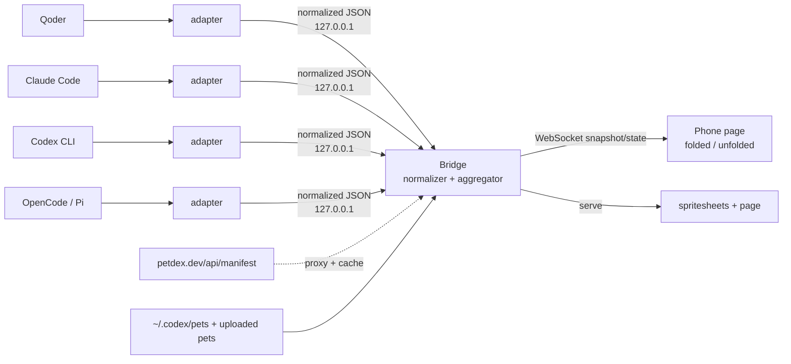

# FoldPet（工作名）— 摺機時鐘 × AI Agent 桌寵

日期：2026-11-21
狀態：設計已通過對話審批，待用戶覆核本文件
平台：macOS bridge ＋ iOS／Android 瀏覽器（零安裝）

## 摘要

把手機（vivo X Fold 5）變成枱面時鐘＋AI coding agent 桌寵：摺合／帳篷擺放時外屏顯示時鐘＋寵物，展開時內屏顯示大舞台＋多 agent session 狀態。Mac 上一個 bridge 收集 Qoder、Claude Code、Codex CLI、OpenCode、Pi 的活動事件，正規化後經區網 WebSocket 推去手機網頁；寵物重用 Petdex 生態（`pet.json` ＋ spritesheet），可從畫廊安裝或自行上傳。手機只作顯示，不安裝任何 app、不經雲端。

成功標準：手機掃一次 QR，之後每次開頁自動連上；五個 agent 任一活動，寵物在 1 秒內反映狀態；摺合／展開版面自適應；同一寵物可與桌面寵物一致；全程免費、無帳號。

## 目標與非目標

**目標**
- 零安裝手機端：iOS Safari／Android Chrome 開啟即用，可加到主螢幕。
- 顯示時鐘、寵物、每個 agent 的只讀狀態（agent、專案資料夾、目前工具／階段、已運行時間、最後事件）。
- 重用 Petdex 寵物包；支援本機安裝、Petdex 畫廊、自行上傳。
- WiFi 區網為主，USB（`adb reverse`／有線）為次；macOS Monterey+ 已移除 Bluetooth PAN，不再作 fallback。
- 私隱優先：事件不離開本機／區網。

**非目標（v1）**
- 遠端批准／拒絕權限、發 prompt、控制 agent。
- 真正 AOD 主題整合（vivo 系統限制）。
- 原生 iOS／Android app、BLE 直連。
- 雲端 relay、多用戶、帳號系統。
- Windows／Linux bridge（v1 只做 macOS，架構不綁死）。

## 使用場景與版面

手機以瀏覽器長開頁面，取代 vivo 靜態「台历熄屏」的精神：時鐘＋會跟 agent 活動的寵物。

| 姿態 | 螢幕 | 版面 |
|---|---|---|
| 摺合／帳篷站立 | 外屏 6.53″ | 大 HH:MM ＋日期；寵物置中偏下舞台；底部 agent chips（狀態點＋名＋狀態） |
| 展開平放 | 內屏 8.03″ | 左上時鐘；中央大寵物舞台；右欄 session cards（agent、專案資料夾、目前工具、已運行時間、最後事件） |

- 版面隨摺合、展開、轉向重排；WebSocket 自動重連，狀態連續。
- 九個 Petdex 狀態；多 session 彙總：任何 agent `waiting` → 寵物等待；否則任何 `failed` → 短暫失敗動畫；否則任何 `running` → 寵物工作（方向由 agent 名 hash 決定）；全部 idle → 發呆，靜置 N 分鐘後睡覺。
- 互動只讀：點寵物有本地反應；齒輪抽屜提供換寵物、靜音時段／調暗、連線資訊。不控制 agent。
- 長亮 best effort：有 secure context 用 Screen Wake Lock；否則抽屜顯示一次性系統設定提示（iOS Auto-Lock → Never；Android 螢幕逾時／Stay awake）。
- 已知限制：vivo AOD 主題系統不能載入第三方 live 內容，因此本頁以螢幕長開方式運作（枱上充電），非真正 AOD。

## 系統架構



| 單元 | 位置 | 職責 | 依賴 |
|---|---|---|---|
| Agent adapters | Mac | 將各 agent 原生事件轉成統一 JSON，POST 去 loopback bridge | 各 agent 的 hook／plugin 機制 |
| Bridge `fold-pet` | Mac（Node 20+ / TypeScript） | 事件正規化、狀態彙總、寵物目錄與驗證、靜態頁與 WebSocket、QR／token、doctor | `ws`、檔案系統 |
| Phone page | 手機瀏覽器（Vite + TS/Canvas） | 時鐘、精靈動畫、自適應版面、重連、喚醒鎖 best effort | Bridge 的 HTTP／WS |

每個單元可獨立理解與替換：adapter 只依賴事件合約；頁面只依賴 bridge 公開 API；bridge 是唯一知道寵物格式與狀態機的地方。

## 事件合約與狀態機

Adapter → bridge（只接受 loopback 來源）：

```json
{
  "v": 1,
  "agent": "claude",
  "sessionId": "abc123",
  "project": "fold-pet",
  "phase": "working",
  "tool": "Edit",
  "detail": "src/app.ts",
  "ts": 1763700000000
}
```

`phase` 為封閉集合：`started | working | waiting | review | done | failed | idle`。`detail` 只放工具名／檔名／階段字串，不放程式碼內容、prompt 或輸出。

| Phase | 精靈狀態 |
|---|---|
| started | `waving` |
| working | `running` |
| waiting | `waiting` |
| review | `review` |
| done | `jumping`（短暫，之後回 idle） |
| failed | `failed`（短暫） |
| idle | `idle` |

- `running-right`／`running-left` 用於舞台上的環境游走，不代表 agent 方向。
- 去抖：同一 session 的連續 `working` 不重置動畫；`done`／`failed` 為一次性動畫。
- Session 追蹤：以 `agent + sessionId` 為鍵；TTL 取代 agent 無通知死亡的情況；斷線重連時頁面先取 snapshot，再收增量。
- 多 session 彙總規則見上一節。

## Bridge API（endpoint／caller 清單）

| Endpoint | Method | Caller | 用途 | 認證 |
|---|---|---|---|---|
| `/api/event` | POST | adapters | 接收正規化事件 | 只限 loopback |
| `/api/state` | GET | phone | 初始 snapshot（sessions ＋目前寵物狀態） | Bearer token |
| `/ws` | WS | phone | 狀態推送＋心跳 | token（query，連上後轉 header） |
| `/` | GET | phone | 顯示頁 | token（一次性 bootstrap query，存 localStorage） |
| `/api/pets` | GET | phone | 可用寵物清單（本機＋快取 manifest） | Bearer token |
| `/api/pets` | POST | phone | 上傳寵物（zip／folder） | Bearer token |
| `/api/active-pet` | PUT | phone | 切換目前寵物 | Bearer token |
| `/assets/pets/*` | GET | phone | spritesheet／pet.json | Bearer token |
| `/health` | GET | doctor | 版本、adapters 狀態、監聽地址 | 只限 loopback |

Token 每次 `fold-pet` 啟動可 rotate；重新印 QR 即撤銷舊連結。上傳設大小上限並拒絕路徑穿越。

## 寵物資產管道

- Petdex 套件格式：每個寵物一個資料夾，內含 `pet.json`（名稱、slug、tags、frame 尺寸、動畫狀態）＋ `spritesheet.webp`／`.png`（8×9 或 v2 8×11 格，每格 192×208，建議 1536×2288，最少 256×256）。
- 來源：`~/.codex/pets/*`（`npx petdex install <slug>` 安裝）、`~/.fold-pet/pets/*`（本頁上傳）、Petdex manifest 代理（`petdex.dev/api/manifest`，快取後由 bridge 提供，避免手機 CORS 與重複下載）。
- 驗證：bridge 檢查 `pet.json` 與 spritesheet 存在、尺寸與格數合規；失敗回傳明確錯誤，不寫入。
- 切換：手機抽屜即時切換；desktop 與 phone 要顯示同一寵物時，兩邊安裝同一 Petdex slug 即可。
- 授權：Petdex 源碼 MIT；寵物圖像版權屬提交者，只在本機／個人使用，不再散佈。

## Agent 接入

| Agent | 機制 | 狀態 | 備註 |
|---|---|---|---|
| Claude Code | hooks（PreToolUse／PostToolUse／Notification／Stop 等） | 有公開文檔，最穩 | v1 首個 adapter |
| Codex CLI | `notify`／hook 程式 | 可行，需對版本實測 | 與 Petdex／Clawd 相同思路 |
| OpenCode | plugin 事件 | 可行，需寫 plugin | 事件較細，需映射 |
| Pi | hook 介面 | Clawd 已支援，需對照驗證 | 研究閘 G5 |
| Qoder | 內建桌面寵物／Petdex 整合 | **研究閘 G1：事件機制未確認** | 可能要 hook、plugin 或 log tail |

與其他寵物 app（Petdex Desktop、Clawd on Desk）並存：installer 採用 chaining，不覆寫別人的 hook；`fold-pet doctor` 檢查每隻 agent 的 hook 是否仍指向正確位置，被覆寫時明確提示。Clawd 為 AGPL-3.0，只作架構參考，不複製其程式碼。

## 安裝與連網

1. `npx fold-pet init`：偵測已安裝 agent、寫入 adapters、建立 `~/.fold-pet/config.json`、選擇預設寵物。
2. `npx fold-pet`：啟動 bridge，terminal 印出 QR（區網 URL＋一次性 token），列出偵測到的網絡位址。
3. 手機掃 QR → 開頁 → 加到主螢幕；之後開頁自動重連。

- 主路徑：Mac 與手機同一 WiFi。
- 次路徑（不同網絡）：USB 接線 + `adb reverse tcp:7788 tcp:7788`，手機開 `http://127.0.0.1:7788/?token=...`；bridge 不需改 IP。macOS Monterey+ 已移除 Bluetooth PAN（本機 `networksetup` 證實），所以不提供藍牙 tethering。
- 長亮：Wake Lock 需要 secure context；純 HTTP LAN IP 不適用，抽屜顯示系統設定指引。USB `adb reverse` 使用 `127.0.0.1`，屬 secure context，可直接使用。本機 HTTPS（手機一次性安裝憑證）列為後續選項。
- 全程免費、無帳號、無雲端。

## 保安與私隱

- 事件端點只接受 loopback；不監聽外網。
- 手機端所有 API／WS 需 token；token 可 rotate、可撤銷。
- 事件只含 agent 名、session id、專案資料夾名、工具名、階段、時間戳；不含程式碼、prompt、輸出。
- 上傳限制大小與格式；拒絕路徑穿越；manifest 代理只允許固定來源。
- 無遙測、無外部請求（除 Petdex manifest 代理與寵物圖片下載）。

## 錯誤處理與邊界

| 情況 | 行為 |
|---|---|
| Bridge 未啟動／斷線 | 頁面顯示「連線中」＋最後狀態，指數退避重連 |
| 手機休眠、轉向、摺合 | 喚醒後自動重連並取最新 snapshot |
| 多個 agent 同時 waiting | chips 閃爍標示等待者；寵物保持 waiting |
| 寵物檔壞／缺失 | 內建 fallback 精靈＋明確錯誤訊息 |
| Hooks 被其他 app 覆寫 | `fold-pet doctor` 偵測並提示修復；installer 用 chaining |
| Token 洩漏／撤銷 | 重新印 QR，舊連結即時失效 |
| Agent 崩潰無 Stop 事件 | session TTL 自動清除 |
| 上傳惡意 zip／路徑穿越 | 拒絕並記錄錯誤 |

## 測試與驗收

- 單元測試：normalizer、phase→state 映射、多 session 彙總、寵物包驗證、manifest 解析。
- 整合測試：以真實事件格式 POST 假 session，驗證 WebSocket snapshot／增量正確；不以捏造 UI 資料代替。
- E2E：Playwright 兩個 viewport（摺合 6.53″、展開 8.03″）截圖與互動；真機 vivo X Fold 5（Android Chrome）＋ iPhone Safari；WiFi LAN／USB `adb reverse` 實測。
- 驗收：Qoder、Claude Code、Codex CLI、OpenCode、Pi 各跑一次真實 session（真事件、真寵物）；摺合／展開各驗一次；斷線重連驗一次。
- 測試不得為綠燈而放寬：負面情境要有正面對照（例如連線 → 斷線 → 重連後狀態一致）。

## 里程碑

| 階段 | 內容 |
|---|---|
| M1 | Bridge ＋ Claude Code adapter ＋ 手機頁（兩姿態）＋ 本機／Petdex 寵物 ＋ QR ＋ doctor；Qoder 機制 spike（G1） |
| M2 | Codex CLI、OpenCode、Pi adapters |
| M3 | Qoder adapter（視 G1 結果）＋ 上傳 UI ＋ USB fallback 引導與（可選）tunnel 評估 |
| M4 | 長亮指引／夜間調暗／真機驗收 |

### M1 實際交付與延後項目

M1 只交付 bridge、Claude Code adapter、手機頁（摺合／展開）、本機／Petdex 寵物目錄、QR／doctor 與 G1 研究。以下條目明確延後至 M2–M4，M1 不實作，也不以自動測試假裝完成：

- 靜置 N 分鐘後睡眠（sleep-after-idle）：延後至 M4 的真機／夜間體驗。
- 舞台環境游走（`running-right`／`running-left` 與 agent 名 hash 決定方向）：延後至 M2。
- 點寵物的本地反應：延後至 M4。
- 抽屜的連線資訊與靜音時段控制（M1 只有寵物選擇與 Wake Lock 狀態）：延後至 M4。
- session card 的「最後事件」欄位：延後至 M2。
- token 輪替／撤銷 CLI：延後至 M3。
- `init` 的預設寵物選擇：延後至 M2。
- WebSocket 心跳：延後至 M2。

其餘里程碑內容不變：Codex／OpenCode／Pi adapters 仍屬 M2；Qoder adapter、寵物上傳 UI 與 USB fallback 引導／（可選）tunnel 評估仍屬 M3。

## 決策更新（2026-11-21 真機測試）

- 原設計以 Bluetooth tethering 作「不同網絡」fallback。真機測試時確認 Apple 已於 macOS Monterey 起移除 Bluetooth PAN：本機 `networksetup -createnetworkservice ... "Bluetooth PAN"` 回傳 `Bluetooth PAN is not a valid hardware port name`，Network 亦無 Bluetooth PAN service，藍牙選單沒有「Connect to Network」。
- 因此 fallback 改為 **USB＋`adb reverse`**（有線）；WiFi 區網仍是主路徑。不同網絡的無線方案（WiFi hotspot／tunnel／relay）留待 M3 評估，M1 不加入雲端。
- 來源：Speedify Android Bluetooth tethering（2026-11 更新）https://support.speedify.com/article/416-tether-android-mac-bluetooth；Apple Discussions https://discussions.apple.com/thread/254761525。

## 風險與具名閘

| 閘 | 風險 | 驗證方法 |
|---|---|---|
| G1 | Qoder 事件機制未確認（可能無公開 hook） | 查 Qoder 文檔、觀察其桌面寵物如何取得事件；必要時 log tail；未確認前不當可交付 |
| G2 | vivo 帳篷模式下瀏覽器螢幕行為與 AOD 不同 | 真機實測：頁面能否長開、摺合時 viewport 尺寸 |
| G3 | 純 HTTP 無 Wake Lock | 真機實測 iOS／Android；以系統設定指引作 fallback |
| G4 | Hooks 與 Petdex Desktop／Clawd 互相覆寫 | 同時安裝實測，doctor 驗證 |
| G5 | Pi hook 介面穩定性 | 對照 Clawd 實作並實測 |

## 參考

- vivo X Fold5 台历熄屏（tent mode AOD）：https://finance.sina.com.cn/tech/roll/2025-07-01/doc-infcyiim5382876.shtml
- vivo X Fold5 規格（內 8.03″ 2480×2200、外 6.53″ 2748×1172）：https://baike.baidu.com/en/item/vivo%20X%20Fold5/1472756
- Petdex 文檔（CLI、桌面 app、hook server、manifest）：https://petdex.dev/docs
- Petdex 套件格式與狀態：https://github.com/crafter-station/petdex
- Qoder 桌面寵物：https://docs.qoder.com/qoder/desktop-pet
- Clawd on Desk（AGPL，架構參考）：https://github.com/rullerzhou-afk/clawd-on-desk
