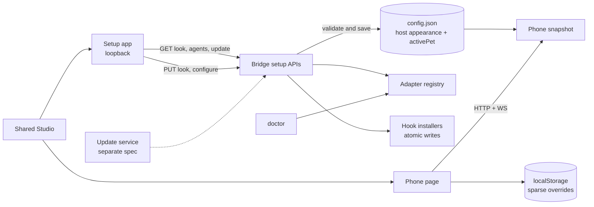

# PocketPet UIUX Direction: Studio Neutral, Desk Dashboard, and Direct Canvas Studio

Status: Draft for review. This document is a design artifact only. It does not authorize implementation, installation, or pushing.
Date: 2026-11-21
Parent spec: [2026-11-21-pocketpet-design.md](2026-11-21-pocketpet-design.md)
Related plans: [PocketPet M1](../plans/2026-11-21-pocketpet-m1.md), [Onboarding](../plans/2026-11-21-pocketpet-onboarding.md)
Related acceptance: [M1 manual](../../acceptance/m1-manual.md), [Qoder manual](../../acceptance/m3-qoder-manual.md)

## Summary

PocketPet's UI moves to a single Studio Neutral design language across two surfaces:

| Surface | Expected outcome |
|---|---|
| Setup dashboard | A loopback-only, computer-hosted dashboard that pairs phones, shows agent adapter status with one-click hook configuration, manages host appearance, and presents update status without hiding failures. |
| Phone display | A dark/light, folded/wide-adaptive clock and pet with a bottom sheet for Live, Look, Agents, and About. Appearance can follow the host or be overridden on this phone. |
| Direct Canvas Studio | A full-screen editor for clock and pet position/scale, plus stack/free layout controls, with numeric fallback and keyboard access. |
| Agent Setup Center | A registry-driven list of known agent adapters with detected, configured, update-needed, adapter-next, and unreadable states. Configuration is explicit, local, and never reads prompts or outputs. |
| Update Center | A visible update state, notify/auto-install settings, adapter refresh after update, and a clear development-build state when no release channel exists. |

The product remains display-only. The phone does not approve, control, or configure agents. Agent configuration is a host-side setup action. The host UI and phone UI never assume macOS; they show the actual computer OS and the platform support that exists.

## Fixed Decisions

- Visual direction: Studio Neutral. Near-monochrome, high contrast, flat surfaces, compact rows, large type, and one structural ink accent. The pet is the only high-chroma content.
- Information architecture: Desk Dashboard on the computer, bottom-sheet tabs on the phone.
- Customization: direct canvas editing, not only sliders. Numeric fields and keyboard controls remain first-class alternatives.
- Appearance scope: host defaults plus per-phone local overrides. No per-posture profiles in this version.
- Agent scope: known adapters only. No generic unknown-IDE detection claim.
- Update scope: notify by default, automatic install off by default, refresh adapters after a successful update. The update mechanism is a separate spec; this spec defines the UI contract and settings.
- OS language: "This computer" and "Host" in copy. Actual OS names are shown as labels, not as assumptions.
- Delivery: design first, then a plan, then implementation. No install or push without explicit approval.

## Goals and Non-Goals

### Goals

- Make pairing, agent setup, appearance, and update state readable in one setup page without a wizard.
- Make hook configuration a visible, explicit, reversible-by-understanding action with an exact file path and no content access.
- Let the user customize clock size, pet size, spacing, layout, theme, motion, and session density on the computer and on each phone.
- Keep the phone fast and calm: the clock and pet are the primary content; controls appear only when opened.
- Use an OS-neutral setup experience with honest support labels.
- Provide measurable acceptance evidence for every UI state and every security boundary.

### Non-Goals

- No agent approvals, commands, or agent control from the phone.
- No generic detection of every IDE on the computer.
- No new agent adapters in this UIUX work. Adapter readiness is reported, not invented.
- No update download, verification, install, or restart mechanism in this spec. The UI contract is defined; the mechanism is a separate spec.
- No Windows or Linux bridge/service implementation. The UI copy is neutral and the support matrix is explicit.
- No push notifications or OS-native notifications. Update notices appear inside PocketPet.
- No server-side per-phone appearance profiles, cloud sync, accounts, or telemetry.
- No freeform drag of session cards. Clock and pet are the only canvas elements.
- No new dependency for the UIUX work; the setup app uses the existing Vite toolchain.

## Relationship to the M1 Spec

This spec supersedes M1 UI-specific points and preserves the M1 contracts below. The M1 acceptance documents remain historical; new acceptance lives in this spec and in the plans that follow it.

| M1 point | New direction | Preserved |
|---|---|---|
| `/setup` is described as Mac-only; a phone opening it sees a "Mac-only" 403 page | The refusal is described as computer-only; the 403 copy says to open the page on the computer running PocketPet. The actual host OS is shown as a label. | `/setup` remains loopback-only; non-loopback requests and wrong Host headers are refused; `Cache-Control: no-store`; QR and tokenized URLs remain server-rendered. |
| The phone's gear drawer holds pet selection, language, debug, and the add-to-home hint | A bottom sheet with Live, Look, Agents, and About tabs. Pet selection moves to Look; language, debug, troubleshooting, and wake status move to About; the add-to-home hint is a one-time dismissible Live row. | Add-to-home behavior, language persistence, debug fields, Wake Lock guidance, and display-only interaction remain. |
| The phone writes `PUT /api/active-pet` and changes the host's pet globally | The phone's pet choice is a local override. Host default pet changes happen only in the setup page. | The pet catalog, sprite pipeline, Petdex validation, and token authentication remain. |
| The phone drawer and host show the same pet because the host pet is global | The host default is the starting point; each phone may override it. When Follow host defaults is on, the phone uses the host pet and appearance. | No agent control is added; the pet is display content. |
| M1 delivers only the Claude Code adapter; Qoder is an M3 item | The setup UI reports adapter readiness from a registry. The current public build has Claude Code ready; Qoder adapter code exists on the unpublished local branch; Codex, OpenCode, and Pi remain adapter-next. | No adapter is installed, pushed, or claimed as verified by this spec. The existing Qoder gate remains open. |
| No external requests except the Petdex manifest proxy and pet images | This spec adds no external request. The Update Center's release check belongs to the separate update mechanism spec. | No telemetry and no cloud account. |

The M1 event contract, phase mapping, session aggregation, HttpOnly cookie, Host allowlist, token bootstrap, Petdex asset validation, and WebSocket snapshot behavior are unchanged.

## Constraints

- Node 20.6 or newer. TypeScript NodeNext ESM. Vite for the web bundles; Vitest for unit tests; Playwright for browser tests.
- The bridge remains the source of truth for host appearance, host pet default, adapter registry state, and update settings.
- The setup page remains loopback-only and Host-allowlisted. The setup web app must not receive the token through setup APIs or place it in script data; the token remains in the server-rendered pairing hero.
- The phone continues to authenticate with the existing token cookie. The phone page never receives host file paths or adapter configuration contents.
- Detection and status reads are side-effect free. No agent process is executed to detect or configure it.
- Tests use a temporary home directory. Automated tests must not touch the real `~/.claude`, `~/.qoder`, `~/.pocketpet`, or launchd state.
- All new UI strings ship in English, Traditional Chinese, and Simplified Chinese. The spec itself is English.
- Every status is conveyed by text plus a dot, never by color alone. The direct canvas is never the only way to set a value.
- The update mechanism is out of scope; the UI must not simulate a successful install when no updater exists.
- Do not push this spec or any implementation without explicit approval. Do not install hooks or services during design verification.

## Design System

### Tokens

The setup and phone surfaces share one token file. Surfaces choose light or dark through the theme setting and `prefers-color-scheme`; no component hardcodes a color.

| Token | Light | Dark |
|---|---|---|
| `--bg` | `#F4F4F2` | `#0E0E0D` |
| `--surface` | `#FFFFFF` | `#171716` |
| `--surface-muted` | `#ECECE8` | `#20201E` |
| `--ink` | `#141412` | `#F4F4F2` |
| `--muted` | `#5F5F58` | `#A3A39B` |
| `--line` | `#D8D8D2` | `#33332F` |
| `--focus` | `#141412` | `#F4F4F2` |
| `--primary-bg` | `#141412` | `#F4F4F2` |
| `--primary-ink` | `#FFFFFF` | `#0E0E0D` |
| `--success` | `#2F6B4F` | `#7BC59B` |
| `--warning` | `#8A5A12` | `#E5B567` |
| `--danger` | `#A82E25` | `#F08A80` |

There is no decorative accent color. Ink is the structural accent. `--success`, `--warning`, and `--danger` are semantic status colors only. The pet sprites are the only high-chroma texture in the normal display.

### Type, Spacing, and Components

| Element | Value |
|---|---|
| Font stack | `ui-sans-serif, -apple-system, BlinkMacSystemFont, "Segoe UI", system-ui, sans-serif`; CJK fallbacks PingFang TC/SC and Noto Sans TC/SC |
| Monospace | Debug values only: `ui-monospace, SFMono-Regular, Menlo, Consolas, monospace` |
| Sizes | 11 label, 13 meta, 15 body, 18 row title, 24 card title, 40 hero; clock base 64 |
| Clock | Tabular numerals; large weight; date below in 13 |
| Labels | Uppercase 11; letter spacing 0.08em; muted |
| Spacing | 4, 8, 12, 16, 24, 32, 48 |
| Rows | 48px minimum; 44px minimum interactive target |
| Cards | 1px `--line`; 8px radius; 24px padding; no shadow |
| Controls | 6px radius; 40–44px height; 1px border; focus ring 2px with 2px offset |
| Sheet | Top radius 12px; 1px border; surface background; scrim over the stage |
| Icons | Inline SVG; 18px or 20px; 1.5px stroke; currentColor; no emoji |
| Motion | 120ms for state changes; 180ms for sheet; no bounce; reduced motion disables |
| Layout | Setup max width 1080px; 12-column grid; 24px gap; Pair spans all 12 columns; Agents, Updates, Look, and System use 6 columns at 880px and wider, 12 below; phone sheet max width 640px |

The setup header is 64px high and contains the wordmark, the "This computer · OS" badge, bridge version, language selector, and a bridge status dot. It is a plain header, not a hero image. The pairing card sits first. There are no gradients, glass, glow, decorative shadows, or emoji.

### OS-Neutral Language

- Setup uses "This computer" and "Host". Phone uses "Computer" and "Host".
- The actual OS is a label: macOS, Windows, or Linux. The label never implies support that has not been implemented.
- The login-service row states the platform support explicitly. The current bridge/service implementation is macOS-only; Windows/Linux bridge and service support are a separate spec. The setup page must not say "Mac" as a generic synonym for the host.
- The old "Mac-only" 403 copy is replaced with "Open this page on the computer running PocketPet." The loopback refusal remains.
- Agent product names (Claude Code, Qoder, Codex CLI, OpenCode, Pi) are not translated.

### Accessibility

- Keyboard: every tab, card action, dialog, and Studio control is reachable; focus is visible; dialogs trap focus and restore it on close.
- The Studio supports arrow keys for movement, Shift+arrow for larger steps, plus/minus for scale, number fields for exact values, and Escape to cancel.
- Tabs use the tablist, tab, and tabpanel semantics. The bottom sheet is a dialog-like region with a clear close or collapse action.
- Status is always dot plus text. The clock and session text can be enlarged by the appearance scale; the sheet must not clip at 200% text zoom.
- The pet canvas has an accessible name ("PocketPet pet") and does not trap focus.
- Motion respects `prefers-reduced-motion` and the Motion setting.
- The setup page includes a skip link to the main content. The no-JavaScript fallback remains readable and usable for pairing.

## Setup: Desk Dashboard

### Serving and Progressive Enhancement

`/setup` remains loopback-only and Host-allowlisted. It is served by the bridge as a server-rendered shell that contains:

- the pairing hero, including the server-generated QR SVG and tokenized URLs;
- the page language selected from `?lang` and Accept-Language;
- the host OS label and bridge version;
- the setup app's hashed JavaScript and CSS asset tags from a Vite manifest;
- a no-JavaScript fallback with pairing steps, URLs, USB fallback, and troubleshooting.

The shell contains no inline script. The setup app is a Vite entry built with the existing web build. The event is not a static `setup.html` served directly: the bridge injects the pairing data and manifest assets so the QR and token stay server-rendered. If the manifest entry is missing, the shell still renders the pairing fallback and the interactive cards report that the setup app is unavailable; it does not render a broken interactive page.

The existing `Cache-Control: no-store`, `X-Content-Type-Options: nosniff`, and `Referrer-Policy: no-referrer` headers remain for the setup page.

The setup page CSP is:

- `default-src 'none'`
- `script-src 'self'`
- `style-src 'self' 'unsafe-inline'` for dynamic CSS variables used by the Studio
- `img-src 'self' data:`
- `connect-src 'self'`
- `base-uri 'none'`
- `form-action 'none'`
- `frame-ancestors 'none'`

The setup page never loads external fonts, scripts, or images. The pairing QR remains an inline SVG. The setup app is not given the host token through setup APIs and does not read or log it; the token remains in the server-rendered pairing hero. The "Open phone view" action opens the tokenized phone URL; that browser tab may become a paired phone through the existing cookie flow, which is an explicit user action.

### Layout

The page is one scrolling dashboard with anchor navigation, not a wizard:

| Order | Card | Content |
|---|---|---|
| 1 | Pair | QR, three steps, LAN URLs, USB fallback, reusable-token note, Open phone view, advanced debug disclosure |
| 2 | Agents | Detected agents first, configured status, adapter-next group, not-detected disclosure, rescan, configure all |
| 3 | Updates | Current and latest version, last checked, notify and auto-install settings, check, apply, progress, adapter refresh result |
| 4 | Look | Folded/wide preview, clock/pet size summary, spacing, host default pet, Open Studio, reset |
| 5 | System | Bridge status, port, version, host OS, USB instructions, login-service status and exact CLI command, log path, copy diagnostics |

The setup page uses the same tokens and component rules as the phone. It does not assume a mouse: all actions are reachable by keyboard. Cards never use a decorative illustration as the only content.

### Setup State Model

- On load, the setup app requests agent, look, and update status. These requests are read-only.
- The pairing hero is usable before the setup app hydrates.
- Actions update only their own card; a failed action never blanks the rest of the page.
- The page does not poll agents in the background. It rescans on explicit request and after configure or adapter refresh.
- The page shows the bridge version and the actual host OS from the bridge, not a browser-derived guess.

## Phone: Bottom-Sheet Display

### Shell

The phone page keeps the existing clock, pet canvas, session chips, WebSocket reconnect, token cleanup, add-to-home behavior, and wake status. The drawer is replaced by a bottom sheet.

- The live scene occupies the viewport, including the safe areas.
- A bottom sheet with a 44px handle and four tabs sits above the scene. The collapsed state shows the tab bar; the expanded state shows the selected panel. The maximum width is 640px on wide viewports.
- Live is the default tab. It shows connection state, host identity, a one-time add-to-home row, and an Edit look action. The clock, pet, and session chips remain on the scene.
- Look contains the host-default summary, Follow host defaults, the pet picker, the Open Studio action, and reset.
- Agents is read-only: adapter names and states, no file paths, no configure buttons. It states that configuration happens on the computer.
- About contains language, host OS, bridge version, connection details, update status, Wake Lock status, troubleshooting, and the existing debug fields.
- The sheet does not cover the pet with a second copy of the scene. It is a control surface, not a second dashboard.

The existing gear control is removed. The tab bar and handle replace it. The add-to-home hint remains one-time and dismissible; it moves to the Live panel. The old "Setup page is Mac-only" troubleshooting copy is replaced by computer-only wording.

### Phone State Model

- On load, the phone fetches the snapshot, merges host appearance with local overrides, and renders the clock, pet, and sessions.
- WebSocket snapshots continue to update sessions, pet, host appearance, and update summary. The phone re-renders only the affected parts.
- The phone never writes host appearance or the host pet default. It writes only its local override object.
- If localStorage is unavailable, the phone uses host values and shows a one-line notice in Look. It does not fail boot.
- If the local pet id is no longer available, the phone falls back to the host pet and notes the fallback in Look.

## Look Model

### Appearance Schema v1

All values are validated and clamped at the bridge and again at the phone boundary. Percent positions are normalized to the stage; scale percentages are relative to the design defaults.

| Group | Field | Default | Range or values | Scope |
|---|---|---|---|---|
| layout | mode | stack | stack, free | Host and phone |
| layout | gap | 16 | 8–48 | Stack mode; host and phone |
| stage | padding | 20 | 8–32 | Host and phone |
| clock | scale | 100 | 60–160 | Host and phone |
| clock | x | 50 | 0–100 | Free mode |
| clock | y | 36 | 0–100 | Free mode |
| clock | format | 24h | 24h, 12h | Host and phone |
| pet | scale | 100 | 80–200 | Host and phone |
| pet | x | 50 | 0–100 | Free mode |
| pet | y | 62 | 0–100 | Free mode |
| theme | mode | system | system, light, dark | Host and phone |
| motion | mode | system | system, full, reduced | Host and phone |
| sessions | density | comfortable | comfortable, compact | Host and phone |
| sessions | maxVisible | 4 | 1–6 | Host and phone |
| sessions | showProject | true | boolean | Host and phone |
| sessions | showTool | true | boolean | Host and phone |
| sessions | showElapsed | true | boolean | Host and phone |

The appearance object carries a version field. Unknown versions fall back to defaults with a visible "Using defaults" notice. Unknown fields are ignored. Invalid numbers are clamped; the UI shows the clamped value, not the rejected input.

The host default pet remains `activePet` in the config. The phone's local pet override is separate from the appearance geometry and is cleared by Follow host defaults.

### Stack and Free Layouts

- Stack mode is the default. The clock and pet form a centered vertical group; `layout.gap` is the vertical gap between them. `stage.padding` protects the safe areas. Positions are managed by the layout.
- Free mode is entered by dragging either element in the Studio or by choosing Free in the layout control. The clock and pet use normalized x/y center anchors and their scales.
- A drag that starts in stack mode switches to free mode with a clear "Free layout" label; Undo can return to the previous mode and positions.
- Reset element returns that element's x/y and scale to the v1 defaults. Reset all returns the entire appearance to defaults, including the mode.
- Values are one set. Folded and wide previews use the same values; the layout engine and safe-area padding adapt. There are no per-posture values in this version.
- Session cards are not draggable. Their density, maximum count, and visible fields are controlled from Look.

### Resolution and Persistence

| Layer | Storage | Contents | Precedence |
|---|---|---|---|
| Host defaults | `~/.pocketpet/config.json`, `appearance` v1 and `activePet` | Full validated appearance and host pet | Base layer |
| Phone overrides | `localStorage["pocketpet.look"]` | Sparse changed fields, `followHost`, optional local pet id | Applied only when Follow host defaults is off |
| Defaults | Code | v1 defaults above | Used for missing or invalid fields |

- Follow host defaults is on by default. When on, the phone ignores local overrides and uses the host values and host pet.
- Turning Follow host defaults off and changing a value creates a sparse local override. Unchanged fields continue to follow the host.
- Reset on this phone clears the local override object and turns Follow host defaults back on.
- The setup page writes host defaults only. The phone never writes host defaults.
- Host changes are broadcast through the existing snapshot/WebSocket path. A phone that follows the host updates immediately; a phone with local overrides updates only inherited fields.
- The phone does not send appearance overrides to the bridge and does not store them in config.

### Direct Canvas Studio

The Studio is one shared web component with two hosts.

| Area | Behavior |
|---|---|
| Entry | Setup: Look card "Open Studio". Phone: Look panel "Open Studio". |
| Toolbar | Close, Undo, Redo, Reset menu, Folded/Wide preview toggle, Snap toggle, Save |
| Canvas | Clock and pet with a selected outline; drag to move; pinch or corner handles to scale; snap to center, edges, and an 8px grid |
| Properties | Element selector, x/y numeric fields, scale numeric field, clock format, layout mode, gap, padding, theme, motion, session density, max visible, show toggles |
| Save scope | Setup writes host defaults. Phone writes this phone. The active scope is always visible as a badge. |
| Undo and redo | At least 30 in-session steps; toolbar and keyboard shortcuts |
| Reset | Reset element and Reset all, both undoable until the editor closes |
| Preview | Setup uses generic folded (9:19.5) and wide (1:1) frames; the phone uses its real viewport. The setup preview is labeled approximate. |
| Sample content | The Studio canvas shows a clearly labeled sample clock, pet, and session strip for layout context. It never presents sample data as live agent state. |
| Keyboard | Tab selects; arrows move by 1%; Shift+arrows move by 10%; plus/minus scales; Enter edits a numeric field; Escape cancels the current edit or closes after confirmation. |
| Accessibility | Numeric fields mirror every drag and pinch action; screen readers announce element, x, y, and scale; focus is trapped only in the full-screen editor. |

The Studio is not a general page builder. It edits clock and pet geometry, layout mode, and the listed appearance fields. Session cards stay a managed list. The live phone page uses the same stage renderer as the Studio preview, so a saved value is what the user sees after closing the editor.

### Stage Rendering

- The live stage contains the clock, the pet, and the session strip. Clock and pet are positioned by the resolved appearance; sessions remain below the stage.
- The stage respects the dynamic viewport height and safe areas in folded and wide postures.
- Clock scale and pet scale apply to their rendered size without changing pixel-art sampling rules. Scaled sprites keep the existing atlas geometry behavior.
- Session density changes row height and em spacing; maxVisible caps the number of session rows; showProject, showTool, and showElapsed control their fields.
- The session strip is not part of the free canvas and never overlaps the clock or pet after clamping. The Studio warns when a free position would place an element under the session strip and offers Reset or a smaller scale.

### Look Data Flow

## Agent Setup Center

### Adapter Registry

The bridge has one adapter registry used by setup, the phone Agents tab, and `doctor`. The registry is the only source of adapter names, detection, hook status, and install capability. The setup UI must not duplicate a hardcoded list of supported agents.

Registry fields:

| Field | Meaning |
|---|---|
| `id` | Stable adapter id used by APIs and URLs |
| `name` | Product name shown in all languages |
| `adapter` | `ready` or `next` |
| `detect` | Side-effect-free detection for a known agent |
| `configured` | Whether every required hook is present and current |
| `hooks` | Required event count, missing count, and whether commands match the current bridge |
| `configure` | Installer capability for ready adapters |
| `settingsPath` | Home-relative settings path for host confirmation; never sent to the phone |

The registry status is data, not a build constant in the UI. A release that contains only the Claude Code adapter shows Claude Code as ready and the other known agents as adapter-next. A release that includes the Qoder adapter may show Qoder as ready. This spec does not ship, install, or assert real Qoder support.

Current state at spec time:

| Agent | Adapter state | UI outcome |
|---|---|---|
| Claude Code | Ready | Detected/configure, configured, or update hooks |
| Qoder | Adapter code exists on the unpublished local branch; not shipped | Adapter next in the public build; configure only in a build that actually contains the adapter |
| Codex CLI | Adapter next | Adapter next; no configure |
| OpenCode | Adapter next | Adapter next; no configure |
| Pi | Adapter next | Adapter next; no configure |

### Detection

- Detection reads only known configuration roots and PATH executables defined by each ready adapter.
- Detection never starts an agent, never runs a prompt, never reads transcript, prompt, tool output, or message content.
- Detection emits a state, not a raw config dump. A malformed settings file becomes "unreadable", not a crash.
- Detection is side-effect free. It must not create a config directory or settings file.
- Detection runs on setup page load, on explicit Rescan, and after a successful configure or adapter refresh. There is no background timer.
- Unknown IDEs are not listed. The UI does not claim support for an agent the registry does not know.

### Agent States

| State | Visual | Text | Action |
|---|---|---|---|
| Ready and configured | Success dot | Configured; show hook count and whether current | Reconfigure; Update hooks if any required event is missing or stale |
| Ready, detected, not configured | Warning dot | Detected; configuration required | Configure |
| Ready, detected, unreadable settings | Danger dot | Can't read settings | Details; show the home-relative path and the failure reason without config content |
| Adapter next | Muted dot | Adapter next | None; refresh after an update |
| Not detected | Muted row | Not detected | Rescan; install the agent; no auto-install |
| Detection error | Danger dot | Can't check | Retry |
| Configure in progress | Muted/disabled | Configuring… | No duplicate submit |
| Configure failed | Danger dot | Configuration failed | Retry; Details with sanitized error |

Detected agents are shown first. Not-detected known agents are in a collapsed disclosure with a count. If none are detected, the card shows an empty state with Rescan and the supported-agent list; it does not show a fake configured agent.

### Configure Flow

1. The user selects Configure or Configure all.
2. A confirmation sheet lists each agent, its home-relative settings path, the number of hook events that will be added, and the statement that PocketPet does not read prompts, messages, tool inputs, or outputs.
3. The user cancels or confirms. The button is the only action that writes.
4. The installer preserves existing settings and third-party hooks, writes atomically, and verifies the resulting status.
5. Each row reports added, unchanged, or failed. A failure leaves other agents unchanged and reports the exact adapter and a sanitized reason.
6. After success, the card offers "Run a prompt in the agent to see the pet move" and does not claim the event pipeline has been verified. Real event verification remains a manual gate.

The setup page never displays a token, agent prompt, transcript, or full settings JSON. It may display a home-relative path; it must not display the user's home directory in the phone UI.

### Phone Agents Tab

The phone Agents tab is read-only. It shows the adapter name, ready/next state, configured state, and a line that configuration happens on the computer. It does not show paths, configure buttons, or update actions. The phone cannot call the setup APIs because they are loopback and CSRF-protected.

## Update Center

### Settings

| Setting | Default | Scope | Meaning |
|---|---|---|---|
| Notify in PocketPet | On | Host | Show update availability in the setup Updates card and as a dot/line on the phone About tab |
| Install automatically | Off | Host | Apply available updates without a per-update click |
| Refresh adapters after update | On | Host | Re-check and refresh hooks for configured agents after a successful update |

Notify is not an OS notification or a push notification. It is an in-product notice. If the user never opens setup or About, no interruption is created.

### Update States

| State | UI | Action |
|---|---|---|
| Development | "Development build; update checks are unavailable" | No check; no fake version |
| Idle | Current version, last checked | Check now |
| Checking | Indeterminate progress; no fabricated percentage | Wait |
| Current | Up to date; last checked | Check again |
| Available | Version, release notes summary, notify badge | Later or Apply; auto-install only if enabled |
| Applying | Download, Verify, Install, Restart, Refresh adapters as real steps | No fake cancel; show the active step |
| Restarting | Bridge restarting; setup page reconnecting; phones reconnect | Reload setup when offered |
| Refreshing adapters | Per-agent refresh result | Details |
| Error | Download, verify, permission, or restart failure | Retry; Details |
| Offline | Last checked and error | Retry |

Apply is an explicit click unless the user enabled automatic install. A confirmation explains that the bridge will restart and phones will reconnect. There is no "success" state without an actual updater result. A failed adapter refresh after a successful update is reported as an agent that needs Update hooks; the update itself is not misreported as fully healthy.

### Update Boundary

The update UI consumes an update state provider. It does not define or implement the download, signature or checksum verification, installation, rollback, restart, or release channel. Those are the subject of a separate update mechanism spec and plan. Until that mechanism exists and a release channel is configured, the UI shows the Development state. The phone shows the read-only state in About and a dot on the About tab when an update is available.

No update is applied from the phone. The setup page is the only update surface.

## APIs and Data Flow

### Setup APIs

All setup reads are loopback-only and Host-allowlisted. All setup mutations additionally require the `X-PocketPet-Setup` header, `Content-Type: application/json`, and an Origin whose host matches the request Host. The bridge does not enable CORS. Requests without these properties are rejected. Setup APIs never return the token, prompt content, transcript content, or full settings JSON.

| Method and path | Purpose | Notes |
|---|---|---|
| `GET /setup` | Server-rendered setup shell and no-JS fallback | QR and tokenized URLs; CSP; no-store |
| `GET /api/setup/agents` | Registry statuses | Home-relative settings path only for ready agents; no raw config |
| `POST /api/setup/agents/:id/configure` | Configure or update hooks | Idempotent; preserves other settings; sanitized result |
| `GET /api/setup/look` | Host appearance, host pet, pet summaries | Includes setup-only sprite URLs |
| `PUT /api/setup/look` | Save host appearance and/or host pet | Validates, clamps, and returns normalized values |
| `GET /api/setup/update` | Update state | Development when no provider or channel exists |
| `PUT /api/setup/update/settings` | Notify, auto-install, refresh adapters | Host settings only |
| `POST /api/setup/update/apply` | Apply an available update | Returns an error in Development; no fake success |
| `GET /assets/setup/pets/...` | Setup preview sprites | Loopback-only; same pet validation and traversal checks as phone assets; no token |

### Phone APIs

| Method and path | Purpose | Notes |
|---|---|---|
| `GET /api/state` | Snapshot plus host appearance, host OS/version, and update summary | Existing token cookie; no file paths |
| `GET /api/agents` | Read-only agent status | No paths; no configure action |
| `GET /api/pets` | Pet summaries | Existing token and validation |
| `GET /assets/pets/...` | Pet sprites and pet.json | Existing token and validation |
| `WS /ws` | Snapshot push | Existing cookie; includes host appearance updates |
| `PUT /api/active-pet` | Legacy phone write path | Not part of the new UI contract; the plan audits callers before removal |

### Error Envelope

Setup API failures return a JSON object with a stable code and a sanitized message. The setup app maps codes to localized copy and offers the next action. It does not display a stack trace, raw file content, the token, or a raw internal path. Client validation errors are inline next to the field. Server validation is authoritative.

### Snapshot Additions

The existing snapshot gains the host appearance, host OS/version label, and a minimal update summary. Existing fields remain. The phone applies local overrides after receiving the snapshot and does not send them back. A host appearance change triggers the existing broadcast; no new WebSocket channel is required.

## Persistence and Compatibility

- `config.json` gains an optional `appearance` object with version 1 and an optional update settings object. Existing config files without these fields load with defaults. No migration step is required.
- The existing `activePet` remains the host default. The phone local pet override is not stored on the bridge.
- The phone local override is stored under `localStorage["pocketpet.look"]`. A malformed object is ignored and the user is told host defaults are in use.
- The phone language key and add-to-home key remain compatible. The setup language is stored separately for the setup origin.
- The WebSocket snapshot type is extended; existing consumers that ignore unknown fields keep working. The phone renderer is updated in the same slice.
- The old phone global pet write is removed from the UI path. The host default pet is written through the setup Look API. Any residual `/api/active-pet` caller is audited in the plan before removal.
- The existing `/setup` loopback and Host checks, token bootstrap, and Petdex proxy contracts remain unchanged.

## Security and Privacy

- Setup is loopback-only. Socket-loopback and a Host header naming the actual listener are both required. DNS rebinding is rejected.
- Setup reads and mutations are separated: reads are loopback and Host checked; mutations also require the custom header, JSON content type, and matching Origin. No CORS is enabled.
- The setup app does not read or log the token, and setup APIs never return it; the token remains in the server-rendered pairing hero. The QR remains server-rendered. The setup-only pet preview endpoints are loopback-only and use the same validation as the phone asset routes.
- Configure actions are explicit. Detection is read-only. No agent is executed for detection. No prompt, message, tool input, or output is read or stored.
- Hook installers preserve third-party settings and write atomically. Errors are sanitized. No token is logged.
- The update UI cannot claim success without the update provider. The update mechanism must verify artifacts and fail closed; the mechanism spec owns that contract.
- No telemetry. No cloud account. This UIUX work adds no external network request. The update mechanism's release check is out of scope and must be reviewed separately.
- No OS-native notifications. Update notices stay in PocketPet.
- Automated tests use a temporary home and a temporary settings path. They must not modify the real user's agent config, launchd state, or PocketPet home.
- No push, install, or real config change occurs during spec review.

## Internationalization and Copy

- English, Traditional Chinese, and Simplified Chinese are required for every new key. A parity test fails if any language is missing a key or contains an untranslated fallback.
- Setup language selection persists for the setup origin. Phone language selection persists as `pocketpet.lang`. The initial language comes from the query or Accept-Language.
- Product names and OS names are not translated. OS labels are exact: macOS, Windows, Linux.
- Terminology is consistent: This computer, Computer, Host, Agent, Adapter, Hooks, Configure, Update hooks, Adapter next, Look, Studio, Follow host defaults, This phone, Notify, Install automatically, Refresh adapters.
- Copy never says Mac as a synonym for the host. The support matrix may say "macOS today" only when it is describing actual platform support.
- Error copy names the failed action and the next action. It never includes a token, full path to the user's home, raw settings content, or a stack trace.
- Empty states are explicit: no agents detected, no pets, update channel unavailable, setup app assets unavailable. No empty state pretends an action succeeded.

## Error and Empty States

| Surface | Condition | Behavior |
|---|---|---|
| Setup | No LAN URL | Show USB fallback and instructions; no invalid QR |
| Setup | No agents detected | Show supported list, Rescan, and install guidance; no fake configured row |
| Setup | Settings unreadable | Show Can't read settings and the relative path; no raw JSON |
| Setup | Configure failed | Keep the row's previous state; show sanitized reason and Retry |
| Setup | Update channel unavailable | Show Development; disable apply; no fake check |
| Setup | Setup assets missing | Pairing fallback remains usable; interactive cards report the missing app |
| Setup | Pet list empty | Show the existing fallback pet and no invented pet |
| Phone | WS disconnected | Show reconnecting and the last known state; exponential backoff |
| Phone | Unauthorized | Show the token/QR troubleshooting path; no token in the URL |
| Phone | Storage unavailable | Use host defaults; show a one-line Look notice; boot continues |
| Phone | Local override invalid | Ignore the bad object, use host defaults, and offer Reset this phone |
| Phone | Local pet missing | Fall back to host pet and note it in Look |
| Studio | Invalid numeric input | Clamp and show the accepted value; keep focus in the field |
| Studio | Save failure | Keep the draft open; show the error and retry; do not claim save |
| Studio | No pet sprite | Show the existing fallback pet; do not block appearance editing |

## Testing and Acceptance

### Test Strategy

- Unit tests cover the appearance schema defaults, clamping, sparse merge, follow-host behavior, layout mode transitions, adapter registry states, detection with a temporary home and PATH, hook status, update state view-model mapping, and i18n key parity.
- Integration tests start the bridge with a temporary home and a temporary agent settings path. They verify setup APIs, loopback and Host refusal, CSRF rejection, configure preservation, no detection writes, setup pet asset authorization, and the setup shell's CSP and manifest asset tags.
- E2E tests use real Playwright browsers and the real bridge. They cover setup cards, configure against temporary settings, Studio drag/resize/numeric/undo/reset/stack-free, host save, phone follow/override, folded and wide viewports, keyboard-only Studio, storage denied, phone tabs, and the read-only Agents tab.
- Update apply E2E is not run until the update mechanism spec and a real release channel exist. The update UI states are unit-tested at the view-model. No fake updater success is used as acceptance.
- Manual gates verify the real phone in folded and wide postures, real host display, and real agent event flow where a real agent config is available. Windows/Linux and real auto-update are NOT RUN in this scope.
- Tests must not skip or loosen assertions to get green. Negative paths have positive controls: allow/deny, configured/unconfigured, follow/override, online/offline, valid/invalid.
- No target test count is invented. The plan records the actual suite count and evidence at implementation time.

### Acceptance Matrix

| Criterion | Producer | Expected evidence | Status at spec |
|---|---|---|---|
| `/setup` is loopback-only and Host-allowlisted | Integration test | 200 for loopback with matching Host; 403 for non-loopback and bad Host | Planned |
| Setup shell has CSP, no-store, QR, and no inline script | Integration test | Response headers and HTML assertions; manifest script and CSS tags | Planned |
| Setup app degrades without JavaScript | Integration test and manual DOM check | Pairing steps, QR, URLs, USB fallback visible; no broken interactive shell | Planned |
| Appearance defaults, clamping, and sparse merge | Unit test | Exact returned values for valid, invalid, and missing fields | Planned |
| Follow host and local override resolution | Unit test and E2E | Host values, local overrides, reset, storage denied, missing pet | Planned |
| Studio supports drag, resize, numeric input, undo, reset, stack, free | E2E | Screenshots and state assertions after each action; reload persistence | Planned |
| Host save applies to follow-host phones | E2E | Setup save, phone state update, no local write on the phone | Planned |
| Phone override survives reload and does not change the host | E2E | Reload shows override; setup still shows host values | Planned |
| Agent detection is read-only | Integration test | No file created or modified on detect; unreadable settings become an error | Planned |
| Configure is explicit, idempotent, preserving | Integration test | Consent gate; hook entries added; unrelated settings unchanged; second run unchanged | Planned |
| Configure all handles partial failure | Integration test | Each result reported; no silent success | Planned |
| Phone Agents tab is read-only | E2E and integration test | No configure control or path; setup API is unreachable from the phone | Planned |
| Setup mutations reject missing CSRF header and cross-origin Origin | Integration test | 403 for missing header and mismatched Origin; valid request succeeds | Planned |
| Update UI has no fake success | Unit test and manual check | Development state when no provider; apply disabled; no success claim | Planned |
| i18n key parity across three languages | Unit test | No missing keys; no untranslated keys | Planned |
| Keyboard-only Studio and focus restoration | E2E and manual | Every value editable without pointer; focus returns to the trigger | Planned |
| Real phone folded and wide | Manual | Screenshots and recorded posture behavior; no overflow; no clipped sheet | NOT RUN |
| Real agent event flow | Manual | Real agent prompt produces the expected pet state; no content captured | NOT RUN |
| Real Windows or Linux host | Manual | Not claimed; separate cross-platform spec | NOT RUN |
| Real auto-update and adapter refresh | Manual | Not claimed; separate update mechanism spec | NOT RUN |
| Real hook installation on the user's machine | Manual | Not performed; explicit user consent required | NOT RUN |

Existing M1 tests that pin the drawer, Mac-only setup copy, and global phone pet write are superseded by the new behavior. The plan updates them with positive and negative controls; it does not delete assertions without replacement.

## Implementation Slices

The slices are recommendations for the plans that follow this spec. Each slice must produce working, testable software. The spec-review gate and plan-approval gate still apply.

| Slice | Scope | Depends on | Exit evidence |
|---|---|---|---|
| 1. Foundation and Look | Shared Studio Neutral tokens; setup web app shell with Pair, Look, and System cards; phone bottom sheet with Live, Look, and About; appearance schema; stage renderer; Direct Canvas Studio; host/phone scope; setup-only pet preview assets | This spec | Setup and phone render the new design; appearance persists; no agent or update UI yet |
| 2. Agent Setup Center | Adapter registry; detection; configure; setup Agents card; phone Agents tab; setup APIs; doctor integration | Foundation | Temp-home configure works; statuses render; no real config touched |
| 3. Update Center | Update settings and states; setup Updates card; phone About badge; update state provider boundary | Update mechanism spec and channel | Development state is honest; UI states pass; no fake apply |
| 4. Release verification | Real phone folded/wide, real agent events, and real update verification where authorized | Slices 1–3 plus explicit approvals | Manual evidence recorded; unrun items remain NOT RUN |

The update mechanism spec is a prerequisite for slice 3. It must define artifact verification, download, installation, restart, and rollback. This spec does not substitute a mock updater for that work.

## Code Touchpoints

These are the existing files the plans will touch. New modules will be named in the plan; this spec does not create code.

| Path | Expected change |
|---|---|
| [src/onboarding.ts](../../../src/onboarding.ts) | Setup shell, no-JS fallback, OS-neutral copy, manifest asset tags, QR and pairing data |
| [src/server.ts](../../../src/server.ts) | Setup app serving and CSP, setup APIs, setup pet preview assets, snapshot additions, phone read-only agents API |
| [src/config.ts](../../../src/config.ts) | Optional appearance and update settings, defaults, atomic save, old-config loading |
| [src/doctor.ts](../../../src/doctor.ts) | Use the shared adapter registry instead of duplicate checks |
| [src/adapters/claudeInstall.ts](../../../src/adapters/claudeInstall.ts) | Registry metadata and status; preserve existing atomic behavior |
| [src/adapters/qoderInstall.ts](../../../src/adapters/qoderInstall.ts) | Registry metadata; remains local and unshipped in the public build |
| [web/vite.config.ts](../../../web/vite.config.ts) | Setup entry and Vite manifest for server-side asset injection |
| [web/index.html](../../../web/index.html) | Phone shell: bottom sheet, tabs, inline SVG controls, no gear glyph |
| [web/src/main.ts](../../../web/src/main.ts) | Phone tabs, resolved appearance, local overrides, read-only agents, About |
| [web/src/style.css](../../../web/src/style.css) | Shared tokens, sheet, Studio, responsive stage, status and focus styles |
| [web/src/i18n.ts](../../../web/src/i18n.ts) | New phone keys in three languages |
| [web/src/catalog.ts](../../../web/src/catalog.ts) | Pet summaries and setup preview links; keep search cap and fallback |
| [web/src/sprite.ts](../../../web/src/sprite.ts) | Scale-aware rendering; preserve atlas geometry |
| [web/src/atlas.ts](../../../web/src/atlas.ts) | No behavioral change unless scale tests expose a gap |
| [web/src/ws.ts](../../../web/src/ws.ts) | Snapshot type extension; reconnect behavior unchanged |

The event contract, auth module, pet validation, Petdex proxy, and launchd service module are not redesigned by this spec.

## Risks and Named Gates

| Gate | Risk | Verification |
|---|---|---|
| G-UIUX-1 | Qoder adapter is present only on the unpublished local branch and is not installed or verified | The registry reports adapter-next in the public build; no real Qoder config is touched; the M1 Qoder gate remains open |
| G-UIUX-2 | The update UI could imply an updater that does not exist | Development state is the only state without a provider; apply is disabled; the update mechanism spec owns verification |
| G-UIUX-3 | Windows and Linux support is not implemented; neutral copy could be read as support | The OS label is factual; the support matrix states the current platform scope; cross-platform work is a separate spec |
| G-UIUX-4 | The stage refactor could regress the M1 folded/wide display | Existing and new E2E viewport tests; real phone manual gate remains NOT RUN until performed |
| G-UIUX-5 | Setup app asset injection or CSP could break pairing | Integration tests for the no-JS fallback, manifest tags, CSP, and 403 paths |
| G-UIUX-6 | Agent detection could produce false configured states | Temp-home positive and negative fixtures; unreadable settings, missing events, stale commands |
| G-UIUX-7 | Host/phone pet behavior changes the M1 global model | Acceptance covers follow host, local override, host save, and reload; old tests are updated with controls |
| G-UIUX-8 | Users may expect OS notifications for updates | The UI copy says notices are in PocketPet; no notification permission is requested |
| G-UIUX-9 | Local-only per-phone appearance is not synced across phones | The model is explicit; Follow host and Reset this phone are visible; no cloud claim |
| G-UIUX-10 | Real config, service, or update actions could be triggered during verification | Tests use a temporary home; the user must explicitly approve any real install, service, or update |

## Open Decisions

None at spec approval. Any change to the fixed decisions, the update boundary, the agent adapter scope, or the security model requires a spec revision and user approval.

## References

- [Parent PocketPet design](2026-11-21-pocketpet-design.md)
- [M1 implementation plan](../plans/2026-11-21-pocketpet-m1.md)
- [Onboarding plan](../plans/2026-11-21-pocketpet-onboarding.md)
- [M1 manual acceptance](../../acceptance/m1-manual.md)
- [Qoder manual acceptance](../../acceptance/m3-qoder-manual.md)
