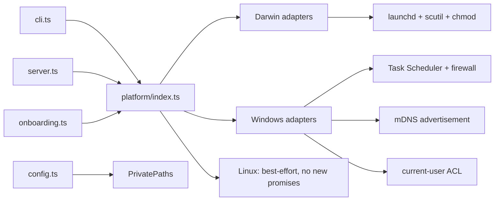

# PocketPet Windows 11 Support Design

Date: 2026-11-23
Status: Approved for planning
Issue: https://github.com/HappyLiang12/pocketpet/issues/2
Scope owner: PocketPet

## Outcome

PocketPet supports Windows 11 x64 as a first-class host alongside macOS. The bridge, phone page, Studio, Claude/Qoder adapter installation, login service, `.local` pairing URL, and owner-only config protection work on Windows, with the same token and loopback security model.

Windows support is proven by a Windows CI job and a Windows 11 real-machine acceptance record. Linux, Windows 10, Windows on ARM, a Windows Service, and agent setup/update UI remain out of scope.

## Fixed decisions

| Area | Decision |
| --- | --- |
| Platform | Windows 11 x64 only, Node.js >= 20.6 |
| Service | Per-user Task Scheduler task at logon, hidden, LeastPrivilege |
| Elevation | One UAC prompt for service install; one for uninstall |
| Firewall | Private-profile rules for TCP bridge port and UDP 5353, added/removed with the service |
| Local name | mDNS A record for `<hostname>.local`, using `multicast-dns` |
| Config protection | Strict current-user-only ACL; inherited and explicit other-user entries removed |
| CI | `macos-latest` and `windows-latest`; real Windows 11 remains a manual gate |
| Linux | Bridge remains best-effort; no service, `.local`, ACL, or support promise |
| Qoder | Adapter wiring remains supported; real-app gate remains NOT RUN |

## Goals

- `pocketpet up`, `run`, `service install|status|uninstall`, `doctor`, and `init` behave correctly on Windows 11 x64.
- The phone page, Studio, token cookie, WebSocket, and all existing appearance features work unchanged.
- The login service survives reboot and starts at user logon.
- `<hostname>.local` resolves from iPhone and Android on the same LAN.
- `~/.pocketpet` and its config, logs, and launcher are readable only by the signed-in user.
- The macOS suite remains green and its launchd behavior is unchanged.
- Every Windows behavior has a producer: unit tests, Windows CI, or a named manual gate.

## Non-goals

- Windows 10, Windows on ARM, Linux support, or a system-wide Windows Service.
- MSI installer, code signing, auto-update, agent setup UI, or update UI.
- Public-network pairing, IPv6 mDNS, VLAN/mDNS reflection, or hostname-collision
  auto-renaming.
- Qoder real-app verification. The Qoder adapter is included and wired; its
  real-app gate remains `NOT RUN`, and `doctor` must say so.
- Any UIUX redesign or change to the existing phone display contract.

## Architecture



The CLI, server, config, and onboarding modules stop calling platform tools
directly. They depend on platform adapters with injectable runners.

### Modules

| Module | Responsibility |
| --- | --- |
| `src/platform/types.ts` | `ServiceManager`, `HostIdentity`, `PrivatePaths` interfaces and shared types |
| `src/platform/index.ts` | Select adapters by `process.platform`; unsupported-platform behavior |
| `src/platform/darwin/service.ts` | Existing launchd/launchctl implementation |
| `src/platform/darwin/hostname.ts` | `scutil --get LocalHostName` normalization |
| `src/platform/darwin/security.ts` | Existing 0700/0600 behavior |
| `src/platform/windows/service.ts` | Task Scheduler task XML, launcher, status, install/uninstall |
| `src/platform/windows/firewall.ts` | Private-profile TCP/UDP firewall rules and removal |
| `src/platform/windows/security.ts` | Current-user-only DACL replacement and verification |
| `src/platform/windows/hostname.ts` | Computer-name sanitization and `.local` construction |
| `src/platform/windows/mdns.ts` | mDNS A-record responder and lifecycle |
| `src/config.ts` | Atomic config write; delegate directory/file protection |
| `src/onboarding.ts` | Pairing URLs; delegate local hostname |
| `src/server.ts` | Setup status and pairing; delegate service and host status |
| `src/cli.ts` | `up`, `run`, `service`, `doctor`; delegate platform operations |
| `src/net.ts` | Ranked LAN IPv4 list shared by QR and mDNS |

Runtime dependency: `multicast-dns` for Windows mDNS; it is lazy-loaded only by
the Windows adapter.

`src/service.ts` is removed after callers move to the adapter. There is exactly
one LaunchAgent implementation and no compatibility shim.

### Interfaces

```ts
type ServiceManager = {
  install(cfg: ServiceConfig): Promise<void>;
  uninstall(cfg: ServiceConfig): Promise<void>;
  status(cfg: ServiceConfig): Promise<{ installed: boolean; running: boolean }>;
};

type HostIdentity = {
  localHostname(): string | null;
  startAdvertisement(): Promise<boolean>;
  stopAdvertisement(): Promise<void>;
};
```

Windows implementations accept injected command runners and filesystem paths
so unit tests do not need a Windows host. macOS implementations preserve the
existing runner shape and refusal to install a source `.ts` CLI.

## Windows service

- Task name: `PocketPet Bridge`.
- Trigger: at logon for the signed-in user.
- Principal: current-user SID, `InteractiveToken`, `LeastPrivilege`.
- Settings: hidden, ignore new instances, start when available, no execution
  time limit, restart up to three times at one-minute intervals.
- Action: `powershell.exe -NoProfile -NonInteractive -ExecutionPolicy Bypass -WindowStyle Hidden -File "<home>\bridge-service.ps1"` with working directory `home`. The earlier `.cmd`/`cmd.exe /d /s /c` action is not used: it corrupts Unicode paths and `%` sequences on the OEM code page.
- Launcher: generated at `<home>/bridge-service.ps1` as UTF-8 with a BOM, current-user ACL, sets `POCKETPET_HOME`, runs `<node> <dist/cli.js> run --service`, and redirects stdout/stderr to `<home>/logs/bridge.log`.
- Task XML is written as UTF-16LE with a BOM before `schtasks /Create /XML`; a BOM-less UTF-16 file is rejected or mis-read by Task Scheduler.
- Task XML, launcher, and log contain no token, QR, or pairing URL.
- Install uses one elevated PowerShell helper to add/update firewall rules,
  register the task, and start it. The helper receives a token-free install
  spec (task XML, action path, firewall arguments) via a PowerShell encoded
  command; it never reads the protected config and writes no user secret to a
  staging file. If the encoded command would exceed the platform limit, install
  fails closed with an actionable error. The launcher and config are written by
  the un-elevated process with current-user ACL, so a UAC elevation that
  requires a different admin account still exposes no user secret. The task
  principal remains the signed-in user. The Node CLI then waits for `/health`.
- Status queries the scheduled task without elevation using the locale-independent `Get-ScheduledTask` State value. `Get-ScheduledTaskInfo` last result/run time is read by the acceptance probe for diagnostics only, not by `service status`. English `schtasks` text parsing is only a fallback, because `schtasks` labels are localized. A task that exists but
  is not running reports `running: false`; the setup System card uses the same
  status on Windows instead of `null`.
- Uninstall ends and deletes the task, removes all PocketPet firewall rules,
  and removes the launcher. It leaves config, pets, cache, and logs in place.
- Install and uninstall are idempotent. Reinstall updates the launcher and task
  paths, for example after a Node upgrade.

### Firewall

Rule names:

- `PocketPet Bridge TCP`
- `PocketPet Bridge mDNS`

Rules are inbound, allow, Private profile only, scoped to the installed Node
executable, with the configured bridge port and UDP 5353. Install removes stale
PocketPet rules before adding the current ones. Uninstall removes both rules.
Public and Domain networks are not opened automatically; `.local` and phone
access may fail there and `doctor` reports the reason.

### Elevation and transaction

`service install` and `service uninstall` use one elevated helper. The helper
receives no secrets. The install order is:

1. Validate the compiled CLI, Node path, config port, and current-user SID.
2. Add/update firewall rules.
3. Write the launcher atomically.
4. Register and start the Task Scheduler task.

If steps 1-4 fail, previously created firewall rules, task, and launcher are
removed. If health fails after the task starts, the task, rules, and log remain
for diagnosis; the command reports unhealthy and does not claim success.

`pocketpet up` behavior:

- `--no-service`: foreground bridge; no firewall changes; no mDNS advertisement
  unless equivalent rules already exist; `.local` is not promised.
- Service selected and UAC accepted: install, wait for health, print pairing.
- UAC canceled or registration failed: print the exact elevated command and
  continue in the foreground. `pocketpet service install` itself exits 1.
- Service installed but health fails: exit 1 with log/status guidance.

## Local hostname and mDNS

- `os.hostname()`/`COMPUTERNAME` is sanitized to a lowercase DNS label:
  replace characters outside `[a-z0-9-]` with `-`, trim leading/trailing
  hyphens, cap at 63 characters, and fall back to `pocketpet` if empty.
- The advertised name is `<sanitized>.local`.
- The responder advertises A records for every ranked non-loopback IPv4
  address, with the same ordering used by `net.ts` for QR URLs. It does not
  advertise AAAA records.
- It responds only to the exact configured name and A queries; it never
  includes the token or any other name.
- On Windows the responder starts only when the PocketPet firewall rules are
  present or an equivalent read-only allow check passes. Foreground `run`
  without those rules does not advertise; `localUrl` is null and
  `--qr-host local` falls back to the IP QR. The responder stops on
  SIGINT/SIGTERM. It is Windows-only; macOS continues to use the system
  Bonjour responder and `scutil`. `startAdvertisement()` returns true only
  while A records are being served; `localHostname()` returns null otherwise.
- If the responder cannot bind, has no IPv4 address, or stops, the bridge
  remains healthy but `localUrl` is null and `doctor` reports a warning.
- `--qr-host local` only selects the `.local` URL when the responder is
  active; otherwise the IP QR remains.
- The setup page decides whether to show `.local` from the live host adapter,
  not from a static hostname.
- Hostname collisions are not auto-renamed. A collision leaves the IP/USB
  fallback usable and is documented as a residual risk.

`net.ts` ranking on Windows:

1. Wi-Fi and Ethernet.
2. Other non-virtual adapters.
3. VPN, vEthernet, Tailscale, and similar virtual adapters.

The ranking is deterministic and shared by the first QR URL and mDNS address
order.

## Config protection

- The protected paths are `home`, `home/config.json`, `home/logs`, and the
  generated launcher. The home DACL uses inheritance flags so existing and
  future children inherit the current-user-only protection; config, logs, and
  launcher are verified directly.
- On creation and on every update, Windows replaces the DACL with a single
  full-control ACE for the current user SID and removes inheritance and all
  other entries. The owner remains the current user. The generated PowerShell
  script builds a `.NET` `SecurityIdentifier` from the SID before creating the
  ACE; the SID string is never passed to an overload that treats it as an
  `NTAccount` name.
- The operation is verified after writing. If verification fails, config
  creation/write fails closed: no token-bearing file is left in a weaker state.
- Existing configs are tightened when loaded or before the service starts. If
  tightening fails, the bridge refuses to start and reports the path and the
  failed operation without printing the token.
- Administrators can take ownership, so the documented guarantee is
  "current-user-only by default; administrators can take ownership." Backup
  tools that run as SYSTEM may not read the file; this is documented.
- POSIX directories remain 0700 and files 0600 on macOS. No fallback to mode
  bits on Windows is claimed.

## Agent hooks and doctor

- Claude Code and Qoder settings updates use the platform private-file helper
  and the Windows absolute `<node> <dist/cli.js> hook ...` command with correct
  quoting.
- Existing symlink/mode tests are platform-gated without weakening the macOS
  assertions. Windows behavior is covered by its own hook-command and ACL tests.
- `doctor` on Windows checks: config ACL, task existence/running, firewall
  rules, mDNS advertisement, bridge health, and hooks.
- `doctor` reports Qoder as wired with the real-app gate `NOT RUN`; it must not
  imply that Qoder has been observed executing the hook. `doctor` PASS for
  Qoder only means the settings wiring exists.

## Pairing and lifecycle

### First `pocketpet up`

1. Create config and secure `~/.pocketpet`; fail if ACL verification fails.
2. Discover/sanitize the Windows hostname.
3. Ask about Claude/Qoder hooks with the existing consent rules.
4. Detect a healthy existing bridge; print pairing and stop if found.
5. Ask "Start bridge at login?" unless `--no-service`.
6. If service: one UAC; firewall, launcher, task, start, health.
7. If foreground: start bridge; start mDNS only when firewall rules are
   present; stop mDNS on Ctrl+C.
8. After health, print IP URLs, `.local` only when active, terminal QR, and USB
   fallback.

### Logon

The Task Scheduler task runs the launcher, which starts the bridge in service
mode. The bridge loads the protected config, starts mDNS, serves the phone page,
and writes the fixed service log line. No UAC is required at logon.

### `run` (foreground)

Loads config, starts bridge, and starts mDNS only when firewall rules are
present; prints pairing; stops both on Ctrl+C. It does not add/remove firewall
rules and does not modify the task. Without rules, `.local` is null; IP and USB
remain available.

### `service status`

Queries the scheduled task without elevation. Exit 0 only when the task is
running; exit 1 when missing or stopped. The setup System card shows the same
running/stopped state on Windows.

## Error handling summary

| Failure | Behavior |
| --- | --- |
| UAC canceled | No side effects; `up` prints elevated command and falls back to foreground; `service install` exits 1 |
| Firewall/task/launcher failure | Roll back all install artifacts; actionable error |
| Task starts but health fails | Keep task/rules/log; report unhealthy; no success claim |
| mDNS bind/no IPv4 failure | Bridge healthy; no `.local`; IP/USB fallback; doctor warning |
| Hostname empty | Use `pocketpet`; log warning |
| Hostname collision | Keep IP/USB fallback; warn; no silent duplicate claim |
| ACL apply/verify failure | Fail closed; do not write or start with a weak config |
| Port changed | Reinstall removes stale PocketPet firewall rules and adds the current port |
| Task deleted/stopped | Status false; `up` offers reinstall or foreground run |
| Node path changed | Reinstall updates launcher/task; doctor compares recorded action with current paths |
| Uninstall with missing rule | Treat as already removed; idempotent |

## Testing

### Unit tests

- `platform.test.ts`: Darwin/Windows dispatch; unsupported-platform behavior.
- `service.windows.test.ts`: task XML, quoting for spaces/Unicode, trigger,
  principal, hidden/restart settings, status parsing, idempotence, rollback,
  no token in XML/launcher.
- `firewall.windows.test.ts`: rule names, private profile, TCP port and UDP
  5353, program scope, stale-rule cleanup.
- `security.windows.test.ts`: SID resolution, single-current-user DACL,
  inheritance removal, verification, fail-closed, macOS chmod regression.
- `hostname.windows.test.ts`: sanitization, empty fallback, `.local`, no invalid
  labels, pairing integration.
- `net.test.ts`: Windows interface ranking (Wi-Fi/Ethernet before VPN/vEthernet)
  and stable QR/mDNS address order.
- `mdns.test.ts`: injected transport; exact-name A answers, ranked IPv4
  records, no AAAA, no response to other names, bind failure, start/stop.
- Existing service/config/install tests remain green; POSIX-only assertions are
  gated by platform without relaxing macOS checks.
- `doctor` test: Windows service/firewall/mDNS checks; Qoder detail says wired
  and real-app gate NOT RUN.

### Windows CI

`.github/workflows/ci.yml` runs a matrix of `macos-latest` and
`windows-latest` with Node 20:

1. `npm ci`
2. `npm test`
3. `npm run build`
4. `npm run typecheck`
5. `npx playwright install chromium`
6. `npx playwright test`

A Windows-only integration step uses unique test names to create/query/delete a
temporary scheduled task, add/remove temporary firewall rules, and verify ACL
on a temporary home. It cleans up in `finally`. It never touches the real
`PocketPet Bridge` task or real PocketPet firewall rules.

`windows-latest` is Windows Server, not Windows 11. It is a regression producer;
it does not replace the Windows 11 real-machine gate below. CI covers the Node 20
minimum; the real Windows 11 gate repeats on Node 24, the issue environment.

## Manual acceptance gates

| Gate | Producer | Initial status |
| --- | --- | --- |
| Clean Windows 11 x64 install, bridge, phone page | Tester | NOT RUN |
| Task Scheduler install, UAC, reboot/logon, status, uninstall | Tester | NOT RUN |
| `.local` resolves from iPhone and Android on LAN | Tester | NOT RUN |
| Firewall rules Private-only and accessible from phone | Tester | NOT RUN |
| ACL current-user-only; another standard user cannot read config | Tester | NOT RUN |
| UAC cancel fallback; firewall/mDNS failure degradation | Tester | NOT RUN |
| Windows 11 real machine with Node 24 (issue environment) | Tester | NOT RUN |
| macOS regression (existing unit/typecheck/build/E2E; final counts recorded in acceptance) | CI + Tester | Required |
| Windows CI matrix | CI | Required |
| Qoder real-app hook observation | Tester | NOT RUN |
| Linux/Windows 10/ARM | Not claimed | NOT RUN |

## Documentation

- Update `README.md` and `README.zh-Hans.md` with a per-OS support table:
  Windows 11 x64 and macOS supported; Linux best-effort without service,
  `.local`, or ACL claims.
- Add Windows quick start, UAC/service behavior, firewall/private-network
  requirements, `.local` resolution, log path, and troubleshooting.
- Update Security with current-user-only ACL wording, administrator ownership,
  and backup limitations.
- Add `docs/acceptance/windows-support.md` with the gates and evidence. Mark
  unexecuted gates `NOT RUN`; never infer them from green CI.
- Keep the Qoder adapter described as included with its real-app gate `NOT RUN`.

## Risks

- Task Scheduler registration may be restricted by policy or elevation; the
  helper must fail with an actionable command and no partial install.
- Firewall rules are Private-profile only; corporate/Public networks may block
  the phone and `.local`.
- mDNS hostname collisions and multi-interface ordering need the IP/USB
  fallback.
- Strict current-user ACL may break SYSTEM backup tools; this is disclosed.
- Windows CI cannot prove Windows 11 firewall, Task Scheduler, or mDNS behavior;
  the real-machine gate is mandatory.
- Playwright and hook tests have Windows path/line-ending and symlink
  differences; platform-gate them without weakening macOS checks.
